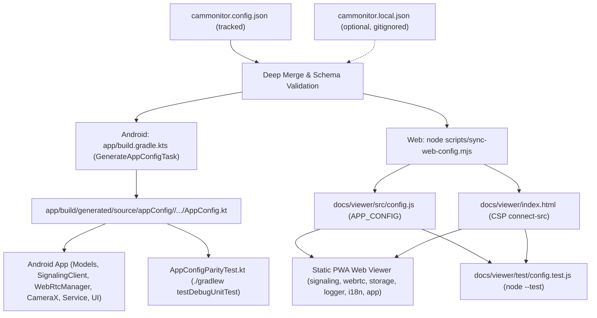

# CamMonitor Configuration Reference (`cammonitor.config.json`)

`cammonitor.config.json` is the **single source of truth** for shared infrastructure URLs, signaling brokers, WebRTC ICE/video settings, device capacity limits, power/standby thresholds, update checks, and log retention across both the **Android app** and the **Browser-Based Web Viewer (`docs/viewer/`)**.

Because JSON does not support comments, this document explains every parameter, its validation rules, where it is consumed, and how the Android and Web config artifacts are generated.

---

## 1. Purpose & Local Overrides

| File | Tracked in Git | Role |
|---|---|---|
| `cammonitor.config.json` | Yes | Base default configuration used by official builds and CI. |
| `cammonitor.local.json` | **No** (`.gitignore`) | Optional local override for private deployments (e.g., private MQTT broker, TURN username/credential, custom fork URL) without dirtying git or leaking secrets. |

### Merge Rules (`cammonitor.local.json` → `cammonitor.config.json`)
Both the Android Gradle generator and the Node.js Web sync script apply the exact same deep-merge algorithm:
- **Nested JSON objects** are merged recursively (you only need to include the specific keys you want to override).
- **Arrays and primitive values** (`brokers`, `iceServers`, strings, numbers, booleans) **replace** the base value completely.

---

## 2. Config Generation & Verification Flow



### Android Path (Automatic on Build)
1. During any Gradle compile/test/assemble task (`assembleDebug`, `assembleRelease`, `testDebugUnitTest`), AGP runs `generateDebugAppConfig` / `generateReleaseAppConfig` (`GenerateAppConfigTask` in `app/build.gradle.kts`).
2. The task parses `cammonitor.config.json` (+ `cammonitor.local.json` if present), validates all constraints, and generates `com.a0soft.gphone.camonitor.config.AppConfig` into `app/build/generated/source/appConfig/<variant>/` (registered via `variant.sources.kotlin.addGeneratedSourceDirectory`).
3. All primitive/string fields are emitted as compile-time `const val`s (zero runtime JSON overhead); existing companion constants (`PairingPayload.DEFAULT_WEB_VIEWER_BASE_URL`, `MqttSignalingClient.PRIMARY_BROKER_HOST`, `SecurityRepository.MAX_PAIRED_CAMERAS`, etc.) delegate directly to `AppConfig`.
4. `AppConfigParityTest.kt` verifies that the compiled `AppConfig` and delegating constants match the root JSON.

### Web Viewer Path (Explicit Static Sync)
Because `docs/viewer/` is served directly as zero-build static files on GitHub Pages:
1. After editing `cammonitor.config.json` (or `cammonitor.local.json`), run:
   ```bash
   node scripts/sync-web-config.mjs
   ```
2. This validates the merged config, regenerates `docs/viewer/src/config.js` (`export const APP_CONFIG = Object.freeze(...)`), and automatically rewrites the `connect-src` directive in `docs/viewer/index.html` so every configured broker's `wss://<host>:<wssPort>` origin is allowed by Content Security Policy.
3. If you are publishing updated files to GitHub Pages, bump `CACHE_NAME` in `docs/viewer/sw.js` (e.g., `cammonitor-viewer-v4` → `cammonitor-viewer-v5`) so installed PWAs pick up the new `config.js`.
4. Verify zero drift before committing:
   ```powershell
   node scripts/sync-web-config.mjs --check
   node --test docs/viewer/test/*.test.js
   .\gradlew.bat testDebugUnitTest
   ```

> **Note:** Both Android PA and the Web Viewer must share the same primary MQTT broker and `signaling.topicPrefix` to communicate.

---

## 3. Complete Parameter Reference

### `project` — Repository Identity & Web Viewer URL

| Key | Type | Default | Validation | Used By | Description |
|---|---|---|---|---|---|
| `project.githubOwner` | `string` | `"samlu"` | Non-empty | Android (`AppConfig`), Web (`APP_CONFIG`) | GitHub username/org owning the repository. Used to derive repo URL (`https://github.com/<owner>/<repo>`), releases page, GitHub Releases API endpoint, and contributors graph URL. |
| `project.githubRepo` | `string` | `"CamMonitor"` | Non-empty | Android (`AppConfig`), Web (`APP_CONFIG`) | GitHub repository name paired with `githubOwner`. |
| `project.webViewerBaseUrl` | `string` | `"https://samlu.github.io/CamMonitor/viewer/"` | Non-empty; must use `https://` (or `http://localhost` / `127.0.0.1`) | Android (`Models.kt`, `CameraPairingScreen.kt`, `AboutScreen.kt`), Web (`app.js` paste placeholder) | Base URL encoded into Camera pairing QR codes (`<webViewerBaseUrl>#pair=<base64url>`), Share/Copy pairing links, and the About screen's Browser Web Viewer card. Keep trailing `/`. |

---

### `signaling` — MQTT Encrypted Signaling Transport

| Key | Type | Default | Validation | Used By | Description |
|---|---|---|---|---|---|
| `signaling.topicPrefix` | `string` | `"cammonitor"` | Non-empty | Android (`SignalingClient.kt`), Web (`signaling.js`) | Root MQTT topic segment. Devices subscribe to `<topicPrefix>/<deviceId>/rx` and publish to `<topicPrefix>/<recipientId>/rx`. Must match between Camera and Viewer. |
| `signaling.keepAliveSec` | `integer` | `30` | `> 0` | Android (`SignalingClient.kt`), Web (`signaling.js`) | MQTT keepalive ping interval in seconds. `30`s stays reliable across mobile NATs and 802.11 DTIM sleep without excessive radio wakeups. |
| `signaling.maxReconnectBackoffMs` | `integer` | `15000` | `> 0` | Android (`SignalingClient.kt`), Web (`signaling.js`) | Maximum delay cap (ms) for exponential MQTT reconnect backoff (`2s → 4s → 8s → cap`). |
| `signaling.brokers` | `array<object>` | HiveMQ (primary), EMQX (secondary) | Non-empty array; **exact count of `primary: true` must be `1`** | Android (`SignalingClient.kt`), Web (`signaling.js`, `index.html` CSP) | Allowlisted MQTT brokers. Android connects to the primary broker via TLS (`tlsPort`); Web connects to the primary broker via WSS (`wssPort` + `wssPath`) and honors any allowlisted `PairingPayload.broker` hint. |
| `signaling.brokers[].host` | `string` | `"broker.hivemq.com"` / `"broker.emqx.io"` | Non-empty | Android + Web + CSP | Broker hostname (also verified against the TLS server certificate on Android). |
| `signaling.brokers[].tlsPort` | `integer` | `8883` | `> 0` | Android (`SignalingClient.kt`) | Raw MQTT-over-TLS TCP port used by Android HiveMQ client. |
| `signaling.brokers[].wssPort` | `integer` | `8884` | `> 0` | Web (`signaling.js`, `index.html` CSP) | MQTT-over-WSS port used by browser `mqtt.min.js`. Also injected into `connect-src` CSP (`wss://<host>:<wssPort>`). |
| `signaling.brokers[].wssPath` | `string` | `"/mqtt"` | Non-empty; must start with `"/"` | Web (`signaling.js`) | WebSocket endpoint path appended to `wss://<host>:<wssPort>`. |
| `signaling.brokers[].primary` | `boolean` | `true` / `false` | Exactly one entry `true` | Android + Web | Designates the default broker used when no override hint is present. If only 1 broker is listed, Android sets `SECONDARY_BROKER_*` equal to the primary broker. |

---

### `webrtc` — ICE Servers & Video Encoding

| Key | Type | Default | Validation | Used By | Description |
|---|---|---|---|---|---|
| `webrtc.iceServers` | `array<object>` | Google public STUN (`stun.l.google.com:19302`, `stun1.l.google.com:19302`) | Non-empty array | Android (`WebRtcManager.kt`), Web (`webrtc.js`) | ICE server list passed to `PeerConnection` / `RTCPeerConnection`. Supports both STUN and TURN entries. |
| `webrtc.iceServers[].urls` | `string` | `"stun:stun.l.google.com:19302"` | Non-empty | Android + Web | STUN or TURN URI (e.g., `stun:...`, `turn:...`, `turns:...`). |
| `webrtc.iceServers[].username` | `string` *(optional)* | *(omitted)* | String if present | Android + Web | Optional TURN authentication username. Put private credentials in gitignored `cammonitor.local.json`. |
| `webrtc.iceServers[].credential` | `string` *(optional)* | *(omitted)* | String if present | Android + Web | Optional TURN authentication password/secret. |
| `webrtc.video.width` | `integer` | `1280` | `> 0` | Android (`WebRtcManager.kt`, `CameraXVideoCapturer.kt`), Web (`app.js` fallback aspect ratio) | Target capture width in pixels (landscape sensor space). |
| `webrtc.video.height` | `integer` | `720` | `> 0` | Android (`WebRtcManager.kt`, `CameraXVideoCapturer.kt`), Web (`app.js` fallback aspect ratio) | Target capture height in pixels (720p HD). |
| `webrtc.video.targetFps` | `integer` | `20` | `> 0` | Android (`WebRtcManager.kt`, `CameraXVideoCapturer.kt`), Web (`app.js` initial FPS display) | Soft FPS target used when selecting the closest hardware-supported AE FPS range on CameraX. |
| `webrtc.video.minBitrateBps` | `integer` | `800000` | `> 0` and `<= maxBitrateBps` | Android (`WebRtcManager.kt`) | Minimum WebRTC video encoder bitrate in bits per second (`800 kbps`). |
| `webrtc.video.maxBitrateBps` | `integer` | `2500000` | `> 0` and `>= minBitrateBps` | Android (`WebRtcManager.kt`) | Maximum WebRTC video encoder bitrate in bits per second (`2.5 Mbps`). |

---

### `limits` — Pairing & Streaming Capacity

| Key | Type | Default | Validation | Used By | Description |
|---|---|---|---|---|---|
| `limits.maxPairedCameras` | `integer` | `8` | `> 0` | Android (`SecurityRepository.kt`, `HomeScreen.kt`), Web (`storage.js`, `app.js` heading & limit check) | Maximum number of cameras a single Viewer (Android or Web) can store in its paired list. |
| `limits.maxPairedViewers` | `integer` | `8` | `> 0` | Android (`SecurityRepository.kt`, `CameraModeScreen.kt`, `CameraPairingScreen.kt`) | Maximum number of authorized viewers stored in a Camera's whitelist. |
| `limits.maxConcurrentViewers` | `integer` | `2` | `> 0` and `<= maxPairedViewers` | Android (`SecurityRepository.kt`, `CameraMonitorService.kt`), Web (`app.js` capacity-reached message) | Maximum number of simultaneous active WebRTC streams per Camera. Additional viewers receive `REJECT("MAX_CAPACITY_REACHED")`. |

---

### `camera` — Standby, OLED Lock, Night Vision & Battery (Android Camera Mode)

| Key | Type | Default | Validation | Used By | Description |
|---|---|---|---|---|---|
| `camera.noViewerPauseMs` | `integer` | `15000` | `> 0` | Android (`CameraMonitorService.kt`) | Milliseconds to wait with `0` active viewers before shutting down the camera sensor (`PAUSED_INACTIVITY`) and releasing `WifiLock` to save battery and prevent overheating. |
| `camera.oledAutoLockSec` | `integer` | `60` | `> 0` | Android (`CameraModeScreen.kt`) | Seconds of touch inactivity in active Camera Mode before automatically entering OLED Black Screen touch-guard (releasing `FLAG_KEEP_SCREEN_ON`). |
| `camera.maxRecoveryAttempts` | `integer` | `5` | `> 0` | Android (`CameraMonitorService.kt`) | Maximum exponential-backoff camera hardware restart attempts after an unexpected HAL/camera disconnect before giving up until the next viewer connects. |
| `camera.nightMode.luxEnter` | `number` | `10.0` | Number; `< luxExit` | Android (`CameraXVideoCapturer.kt`) | Ambient light threshold (lux) below which `AUTO` Night Mode activates low-light enhancement. |
| `camera.nightMode.luxExit` | `number` | `25.0` | Number; `> luxEnter` | Android (`CameraXVideoCapturer.kt`) | Ambient light threshold (lux) above which `AUTO` Night Mode exits back to normal capture. Hysteresis (`luxExit > luxEnter`) prevents flickering. |
| `camera.nightMode.debounceMs` | `integer` | `1500` | `> 0` | Android (`CameraXVideoCapturer.kt`) | Milliseconds the ambient light reading must stay past a threshold before switching Night Mode state. |
| `camera.battery.lowPercent` | `integer` | `20` | `0 < lowPercent <= broadcastWarnPercent` | Android (`HomeLogic.kt`) | Battery level (%) at or below which (when unplugged) the Home pre-flight bar displays a red Low Battery warning. |
| `camera.battery.broadcastWarnPercent` | `integer` | `30` | `lowPercent <= broadcastWarnPercent < 100` | Android (`HomeLogic.kt`) | Earlier battery level (%) at or below which (when unplugged) the Broadcaster card displays an amber plug-in reminder above the Start buttons. |

---

### `updates` — GitHub Releases Auto-Update Policy (Android)

| Key | Type | Default | Validation | Used By | Description |
|---|---|---|---|---|---|
| `updates.checkIntervalHours` | `integer` | `24` | `> 0` | Android (`UpdateWorkScheduler.kt`, `UpdatePreferenceManager.kt`) | WorkManager periodic check interval and foreground check cooldown (in hours) to respect GitHub unauthenticated API rate limits (60 req/hr). |
| `updates.flexIntervalHours` | `integer` | `4` | `> 0` | Android (`UpdateWorkScheduler.kt`) | WorkManager flex window (in hours) allowing Android to batch background update checks for better battery efficiency. |
| `updates.httpTimeoutMs` | `integer` | `10000` | `> 0` | Android (`ReleaseChecker.kt`) | Connect and read timeout (ms) for querying the GitHub Releases REST API. |

---

### `logging` — Diagnostic Log Retention

| Key | Type | Default | Validation | Used By | Description |
|---|---|---|---|---|---|
| `logging.maxFileSizeMb` | `integer` | `8` | `> 0` | Android (`AppLogger.kt`) | Per-file rotation size limit in megabytes (`8 MB` holds roughly 1 day of INFO logs). |
| `logging.maxBackupFiles` | `integer` | `5` | `> 0` | Android (`AppLogger.kt`) | Number of rotated backup log files retained on disk (total files = `maxBackupFiles + 1`, so `6 × 8 MB ≈ 48 MB`). |
| `logging.androidMemoryEntries` | `integer` | `500` | `> 0` | Android (`AppLogger.kt`) | In-memory ring-buffer capacity shown in the Android Log Viewer UI. |
| `logging.webMemoryEntries` | `integer` | `300` | `> 0` | Web (`logger.js`) | In-memory ring-buffer capacity shown in the Web Viewer's Diagnostic Logs drawer. |

---

## 4. Example `cammonitor.local.json` Override

To test a private broker and TURN server locally without modifying tracked files, create `cammonitor.local.json` at the repo root:

```json
{
  "project": {
    "githubOwner": "myuser",
    "webViewerBaseUrl": "https://myuser.github.io/CamMonitor/viewer/"
  },
  "signaling": {
    "brokers": [
      {
        "host": "mqtt.example.com",
        "tlsPort": 8883,
        "wssPort": 8884,
        "wssPath": "/mqtt",
        "primary": true
      }
    ]
  },
  "webrtc": {
    "iceServers": [
      { "urls": "stun:stun.l.google.com:19302" },
      {
        "urls": "turn:turn.example.com:3478",
        "username": "cammonitor",
        "credential": "replace-with-secret"
      }
    ]
  }
}
```

Then run `node scripts/sync-web-config.mjs` (for the Web Viewer) and `.\gradlew.bat assembleDebug` (for Android).

---

## 5. What Is Intentionally NOT in `cammonitor.config.json`

The following values remain hardcoded in source by design so accidental edits cannot break wire compatibility, weaken security, or wipe user pairings:
- **Cryptographic primitives & HKDF info labels**: `secp256r1`, `"CamMonitor-OTP"`, `"CamMonitor-E2EE"`, 12-byte GCM IV, 128-bit GCM tag.
- **Anti-replay security window**: `±120,000 ms` timestamp tolerance and nonce retention TTL.
- **Persistence & OS identifiers**: `cammonitor_secure_prefs`, `cammonitor_web_db`, Android notification channel IDs, WorkManager unique work name.
- **Internal UI micro-timings**: touch-guard arm delay (`300 ms`), swipe-to-unlock threshold (`0.3` / `120 px`), border alphas.
