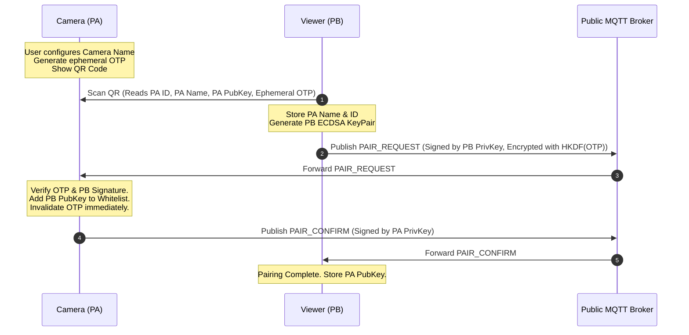
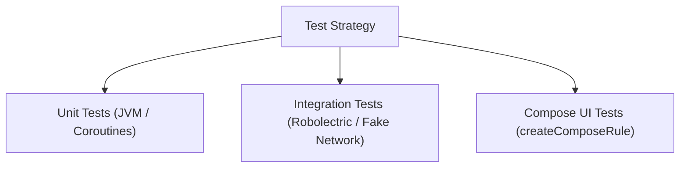

# CamMonitor — System Specification

## 1. Overview
CamMonitor is a peer-to-peer camera monitoring Android application running across two device roles:
* **Camera Mode (PA - Sender):** Captures 720p video (using hardware-supported AE FPS range closest to soft constraint 20fps, e.g. 15–24fps) and audio via CameraX with dynamic Night extension (`ExtensionMode.NIGHT`) and Camera2 low-light fallback, ambient light sensor monitoring with debounced hysteresis, customizable device naming/renaming, remote flashlight control, 2-way talkback, battery-saving OLED black screen, and real-time battery status reporting.
* **Viewer Mode (PB - Receiver):** Streams real-time video/audio, displays PA's custom device name with real-time rename synchronization, monitors real-time battery percentages & charging statuses of both devices (PA camera & PB viewer), provides a 3-way Night mode toggle (`Auto` / `Night` / `Normal`), supports 90° rotation increments, remote flashlight toggle, and push-to-talk intercom.
* **Diagnostics & Logging:** Integrated persistent file-based rolling logger. Logs connection states, WebRTC ICE steps, signaling envelopes, camera lifecycle, and security verifications to local files, complete with an in-app log viewer and export/share feature.
* **Testability & Quality Assurance:** Architected for 100% deterministic testability with interface-driven abstraction layers, fake implementations, Coroutine `TestDispatcher` time control, and comprehensive Unit, Integration, and Compose UI test suites.
* **Platform & SDK Targets:**
  * **Application ID / Package Name:** `com.a0soft.gphone.camonitor`
  * **Current App Version:** `1.0.5` (`versionCode = 6`)
  * **Minimum SDK (`minSdk`):** `28` (Android 9 Pie)
  * **Target SDK (`targetSdk`):** `37` (Android 17)
  * **Compile SDK (`compileSdk`):** `37`
  * **Native Binary Compatibility:** 16 KB ELF page-size alignment verified for WebRTC native libraries (`libjingle_peerconnection_so.so`), ensuring compliance with Android 15+ (API 35+) memory paging requirements.
* **UI Architecture:** Built 100% with **Jetpack Compose** (Material 3) adhering strictly to modern Android and Compose best practices.
* **Security Model:** **Strict Zero-Trust Access Control.** Only explicitly paired viewers can establish signaling, negotiate WebRTC, or receive media. Unauthorized or unauthenticated connection attempts are dropped with zero data leakage.
* **Network & Infrastructure Scope:** 
  * **Zero-Account Setup:** Requires no cloud accounts, no API keys, and no custom hosted servers.
  * **Signaling:** Public TLS-encrypted MQTT broker (`broker.hivemq.com:8883` / `broker.emqx.io:8883`). All signaling payloads are authenticated and encrypted end-to-end.
  * **NAT Traversal Scope:** Uses Google Public STUN (`stun:stun.l.google.com:19302`) + LAN direct host candidates. Direct P2P connection works across LAN, port-restricted cone NATs, and WAN whenever at least one device has a non-symmetric NAT or a public IP. Symmetric-to-symmetric NAT across separate WAN networks is explicitly out of scope.

---

## 2. Security Architecture & Access Control



### 2.1 Cryptographic Primitives & Storage
1. **Device Identity Keys:**
   * Each device generates an asymmetric **ECDSA (secp256r1 / NIST P-256)** keypair stored in the **Android Keystore** (`AndroidKeyStore` provider).
   * Private keys are hardware-backed (TEE/StrongBox) and never exportable in plaintext.
2. **Key Storage & Whitelisting:**
   * **Camera (PA):** Maintains an **Authorized Viewer Whitelist** (maximum 2 devices) containing:
     * `viewerDeviceId`: String (UUID v4)
     * `viewerPublicKey`: String (Base64 X.509 encoded public key)
     * `deviceAlias`: String (e.g., "Dad's Pixel 8")
     * `pairedTimestamp`: Long
   * **Viewer (PB):** Can pair with up to **8 Camera devices** (`MAX_PAIRED_CAMERAS = 8`) containing:
     * `cameraDeviceId`: String (UUID v4)
     * `cameraPublicKey`: String (Base64 X.509 encoded public key)
     * `cameraAlias`: String (e.g., "Living Room Cam")
     * `pairedTimestamp`: Long
   * Whitelist and local device name are persisted in Android `EncryptedSharedPreferences` backed by `MasterKey`.

### 2.2 Pairing Security Lifecycle & Device Naming
* **Device Name Configuration on PA:**
  * Default name generated as `"CamMonitor-" + last 4 chars of UUID` (e.g., `"CamMonitor-8A2F"`).
  * User can customize/rename this at any time via PA's UI.
  * Name length: 1 to 32 UTF-8 characters.
* **Ephemeral One-Time Token (OTP):**
  * The QR code payload contains a cryptographically random 256-bit pairing secret (`pairingOtp`).
  * The OTP is **single-use and short-lived** (expires after 5 minutes or immediately upon a successful pairing).
  * If the pairing screen on PA is dismissed or cancelled, the OTP is instantly discarded.
* **Mutual Authentication Handshake:**
  * PB encrypts its enrollment payload with a key derived from the OTP via HKDF-SHA256.
  * PA verifies the OTP. If valid, PA pins PB's public key into its hardware-backed whitelist.
  * Once 2 viewers are paired, PA closes the pairing interface and rejects any further pairing requests.

### 2.3 Signaling Message Authentication & Anti-Replay
Every signaling envelope sent over the public MQTT broker is structured as:

```json
{
  "senderId": "pb-uuid",
  "recipientId": "pa-uuid",
  "timestamp": 1728723600000,
  "nonce": "random-16-bytes-hex",
  "ciphertext": "base64-aes-256-gcm-payload",
  "iv": "base64-12-bytes-iv",
  "tag": "base64-16-bytes-gcm-tag",
  "signature": "base64-ecdsa-signature-of-envelope"
}
```

* **Verification Protocol on PA:**
  1. **Whitelist Check:** Is `senderId` present in PA's Authorized Viewer Whitelist? If NO $\to$ Silently discard.
  2. **Replay Window Check:** Is `|currentTime - timestamp| < 30 seconds` AND is `nonce` unseen? If NO $\to$ Silently discard.
  3. **Signature Verification:** Verify `signature` over `(senderId + recipientId + timestamp + nonce + ciphertext)` using the stored `viewerPublicKey`. If Invalid $\to$ Silently discard.
  4. **Decryption:** Decrypt `ciphertext` via AES-256-GCM using the shared secret derived from ECDH (PA Private Key + PB Public Key).
* **Zero-Leakage Guarantee:** Unauthorized third parties cannot trigger camera activation, read SDP metadata, or inject malicious SDP offers.

### 2.4 Dynamic Device Renaming Synchronization
* When a user renames PA (either in Home Screen or while streaming):
  1. PA updates local persistent storage.
  2. If viewers are actively connected, PA broadcasts an authenticated control command over all active WebRTC DataChannels:
     ```json
     {"cmd": "RENAME", "name": "Baby Nursery Cam"}
     ```
  3. Active PB viewers instantly update their top HUD title and local persistent database record for this PA.
  4. If PB is disconnected (or hasn't connected yet) when PA is renamed:
     * **Signaling Handshake Sync:** PA includes its current device name inside the encrypted WebRTC `ANSWER` signaling message (`{"type": "ANSWER", "sdp": "...", "cameraName": "..."}`). PB updates its local persistent store and HUD title immediately upon applying the Answer.
     * **DataChannel Open Sync:** As soon as the WebRTC DataChannel transitions to `OPEN`, PA automatically dispatches a `RENAME` command carrying the latest camera name.
     * **Query Status Sync:** Any incoming `QUERY_BATTERY` command from PB elicits both the latest battery status and a `RENAME` command with the latest camera name.

### 2.5 Media Stream & WebRTC Security
* **DTLS-SRTP Fingerprint Verification:**
  * WebRTC media is encrypted end-to-end via DTLS-SRTP.
  * The DTLS certificate fingerprint is embedded within the authenticated and signed SDP offer/answer.
* **Role-Based Access Control & Whitelist Filtering:**
  * **Camera (PA):** Verifies that incoming signaling messages originate exclusively from devices in `getPairedViewers()`.
  * **Viewer (PB):** Resolves target cameras exclusively from `getPairedCameras()`.
* **Gated Remote Intercom Audio:**
  * Incoming viewer `AudioTrack`s on Camera (PA) are initialized in the **disabled** state (`track.setEnabled(false)`).
  * Audio is enabled dynamically only upon verified receipt of `ControlCommand.PttStart` and routed to speaker.
  * Multi-viewer PTT states are tracked per peer (`activePttPeers = ConcurrentHashMap.newKeySet<String>()`), ensuring one viewer's release does not clobber another viewer's active intercom session. PTT state is purged on peer disconnection or close.
* **DataChannel Command Authentication & State Synchronization:**
  * Remote commands (`TORCH`, `TORCH_REPORT`, `PTT`, `RENAME`, `BATTERY`, `QUERY_BATTERY`, `SET_NIGHT_MODE`, `NIGHT_MODE_REPORT`, `FPS_REPORT`) are only accepted on DataChannels belonging to authenticated WebRTC PeerConnections established via the verified signaling handshake.
  * Flashlight status is bidirectionally synchronized: PA dispatches `TORCH_REPORT` on DataChannel open, in response to `QUERY_BATTERY`, and immediately upon local or remote torch toggles.

### 2.6 Revocation & Unpairing
* Both devices provide device unpairing options:
  * Via the dedicated **"Manage Paired Devices"** screen.
  * PB also allows quick unpairing directly within the **Camera Selection Dialog**.
* When a user removes a paired device:
  1. The target device's key and metadata are wiped from persistent storage.
  2. Any active WebRTC `PeerConnection` with that device is immediately terminated.
  3. Subsequent signaling messages from that device fail authentication/whitelist checks and are dropped.

---

## 3. Persistent Diagnostics & File Logging System

### 3.1 Architecture & Storage
* **Location:** Written exclusively to application-specific sandboxed internal storage:
  `context.filesDir/logs/cammonitor.log`
  *(Protected from world/MTP access on Android 9+; accessible through the in-app log viewer and system share sheet).*
  * Any legacy external logs under `context.getExternalFilesDir("logs")` are automatically purged on startup.
* **Thread-Safe StateFlow:** In-memory diagnostic logs are updated atomically using a Compare-And-Swap (CAS) loop via `_logsFlow.update { ... }`.
* **Rolling Policy:**
  * Max file size: **2 MB** per file.
  * File rotation: Keeps up to **3 rolling backups** (`cammonitor.log`, `cammonitor.1.log`, `cammonitor.2.log`).
  * Total disk budget: Capped at **~6 MB** maximum.
* **Log Entry Format:**
  `[2026-10-12 17:20:01.432] [INFO] [WebRTCManager] ICE connection state changed: CONNECTED`

### 3.2 Key Events Logged
1. **Signaling & MQTT:**
   * MQTT connection state (`CONNECTING`, `CONNECTED`, `TLS_ESTABLISHED`, `DISCONNECTED`).
   * Topic subscriptions and publications (sanitized, excluding raw encryption keys).
   * Handshake drop events with reason codes (`REJECT_UNAUTHORIZED_SENDER`, `REJECT_REPLAY_DETECTED`, `REJECT_MAX_CAPACITY`).
2. **WebRTC & Media Pipeline:**
   * Local & Remote SDP generation and set state (`OfferCreated`, `AnswerApplied`).
   * ICE gathering state, candidate counts (Host, Srflx/STUN), and pair selection.
   * `IceConnectionState` & `PeerConnectionState` transitions (`CHECKING`, `CONNECTED`, `FAILED`, `DISCONNECTED`).
   * Camera lifecycle events: Camera open, frame encoder initialization, sensor errors, torch toggles, ambient light sensor readings, and dynamic Night Extension rebinds (`ExtensionMode.NIGHT`).
3. **Power & App Lifecycle:**
   * Foreground Service startup, shutdown, and notification bindings.
   * OLED Black Screen activations, tap-to-wake events, and 60-second idle countdown triggers.
   * 60s viewer absence camera release triggers.
4. **DataChannel Messages:**
   * Inbound and outbound control messages (`TORCH`, `PTT_START`, `PTT_STOP`, `RENAME`, `BATTERY`, `QUERY_BATTERY`, `SET_NIGHT_MODE`, `NIGHT_MODE_REPORT`).

---

## 4. UI Architecture & Jetpack Compose Standards

### 4.1 Design Guidelines & Theme
* **Toolkit:** Jetpack Compose with Material 3 (`androidx.compose.material3`).
* **Design Philosophy:** Dark-first UI (OLED power conservation, minimal distraction for monitor usage).
* **Color Palette (Dark Theme Tokens):**
  * `Primary`: Cyan / Teal Accent (`#00E5FF` / `#00B4D8`) — high visibility for status indicators.
  * `Surface`: Deep Charcoal (`#121212`), `SurfaceContainer`: (`#1E1E1E`), `SurfaceContainerHigh`: (`#2A2A2A`).
  * `StatusLive`: Emerald Green (`#00E676`).
  * `StatusWarning`: Amber (`#FFD600`).
  * `StatusError`: Sunset Red (`#FF5252`).
* **Typography:** Material 3 Type Scale with monospace formatting for technical metrics (FPS, resolution, timers, logs).
* **Adaptive App Launcher Icon:**
  * Canvas dimension: $108 \times 108\text{ dp}$.
  * Safe Zone Compliance: All critical visual elements (camera body, lens, pupil, monitor status dot) are strictly centered inside the Material Design circular safe zone of diameter $66\text{ dp}$ (centered at coordinates $(54, 54)$ with radius $33\text{ dp}$), preventing clipping across all OEM adaptive masking geometries (circle, squircle, rounded square).
  * Layering: Features dedicated foreground (`ic_launcher_foreground.xml`), dark background (`ic_launcher_background.xml`), and tinted monochrome (`ic_launcher_monochrome.xml`) layers for full Material You dynamic theming on Android 13+.

### 4.2 State Architecture & Recomposition Best Practices
* **Unidirectional Data Flow (UDF):**
  * State flows down via immutable `@Immutable` data classes exposed by `StateFlow<UiState>`.
  * Events flow up via ViewModel function invocations or UI event lambdas.
  * UI state collected via `collectAsStateWithLifecycle()` in composable functions.
* **Stateful vs. Stateless Pattern:**
  * Every screen is structured as:
    * `XxxRoute` (Stateful): Injects `ViewModel`, handles navigation events.
    * `XxxScreen` (Stateless): Takes `uiState` and callback lambdas (`onEvent: () -> Unit`). Enables Compose Previews and isolated unit testing.
* **Hybrid View Interop (`AndroidView`):**
  * WebRTC's `SurfaceViewRenderer` and Camera preview are wrapped via `AndroidView` with explicit `DisposableEffect` cleanups:
    * `SurfaceViewRenderer.release()` called on disposal.
    * Camera2 / CameraX providers unbound on disposal.

---

## 5. Detailed UI Screen Specifications

### 5.1 Screen 1: Mode Selection (Home Screen)
* **Top App Bar:**
  * Title: `"CamMonitor"` (HeadlineMedium, bold).
  * Actions:
    * `IconButton(Icons.Default.Language)` $\to$ Opens **Language Selector Menu** (`"System Default"`, `"English"`, `"繁體中文"`).
    * `IconButton(Icons.Default.Description)` $\to$ Opens **In-App Log Viewer**.
    * `IconButton(Icons.Default.Devices)` $\to$ Opens **Paired Devices Management**.
    * `IconButton(Icons.Default.Info)` $\to$ Opens **About Screen** (`AppScreen.ABOUT`).
* **Body Layout & Adaptive Orientation:**
  * Enabled with vertical scroll (`Modifier.verticalScroll(rememberScrollState())`) to guarantee complete access across all screen densities and font scales.
  * **Portrait Mode:** Cards are centered vertically in a `Column` with 24dp vertical spacing.
  * **Landscape Mode:** Cards adapt dynamically into a side-by-side `Row` with 16dp spacing where each card takes equal width (`Modifier.weight(1f)`) and equal height (`height(IntrinsicSize.Max)` and `fillMaxHeight()`), ensuring 100% of both cards and their action buttons are fully visible without cropping and symmetrically aligned.
  1. **Camera Mode Card:**
     * Icon: `Icons.Default.Videocam` (48dp, Primary color tint).
     * Title: `"Start Camera Mode"` (TitleLarge).
     * Subtitle: Dynamic status:
       * 0 paired viewers: `"No viewers paired (tap to pair)"`.
       * 1 paired viewer: `"Paired with <Viewer Name>"`.
       * 2 paired viewers: `"2 viewers paired (broadcasting ready)"`.
     * Current Camera Name Pill: e.g. `"Camera Name: Living Room Cam"` with edit pencil icon button.
     * Paired Viewers Summary Row:
       * Label: `"Paired Viewers (<count>/2)"`.
       * Action: `"Pair Viewer"` button with `+` icon (visible if count $< 2$) $\to$ Launches QR code display.
     * Click Action:
       * If 0 viewers: Navigates to Screen 5.2.1 (Camera Pairing QR Display).
       * If $\ge 1$ viewers: Directly starts Camera Mode streaming.
  2. **Viewer Mode Card:**
     * Icon: `Icons.Default.Visibility` (48dp, Secondary color tint).
     * Title: `"Start Viewer Mode"` (TitleLarge).
     * Subtitle: Dynamic status:
       * 0 paired cameras: `"No paired camera (tap to pair)"`.
       * 1 paired camera: `"Paired with <Camera Name>"`.
       * $>1$ paired cameras: `"<N> cameras paired (tap to choose)"`.
     * Paired Cameras Summary Row:
       * Label: `"Paired Cameras (<count>/8)"`.
       * Action: `"Pair Camera"` button with `+` icon (visible if count $< 8$).
     * Click Action:
       * If 0 cameras: Navigates to Screen 5.2.2 (Viewer Pairing QR Scanner).
       * If 1 camera: Directly launches Viewer Mode targeting that camera.
       * If $>1$ cameras: Opens **Camera Selection Dialog**.
* **Camera Selection Dialog (Compose AlertDialog):**
  * Trigger: Tapping Viewer Mode Card when multiple cameras ($>1$) are paired.
  * Title: `"Select Camera to View"`.
  * Subtitle: `"Choose which camera stream to view:"`.
  * Camera List (`LazyColumn`):
    * Displays each paired camera with `Icons.Default.Videocam`, camera name, truncated ID snippet, connect arrow, and a quick-remove red trash icon (`Icons.Default.Delete`).
    * Tapping any camera immediately launches Viewer Mode connecting to that camera.
    * Tapping trash icon immediately unpairs the camera.
  * Bottom Action:
    * `"Pair Another Camera (<count>/8)"` button (visible if count $< 8$) to launch QR scanner.
  * Dismiss Action: `[Cancel]`.
* **Camera Name Edit Dialog (Compose AlertDialog):**
  * Trigger: Tapping the edit pencil on Camera Mode card or inside Camera Mode settings.
  * Title: `"Rename Camera"`
  * Input: `OutlinedTextField` with character counter (`0/32`) and single-line restriction.
  * Buttons: `[Cancel]` and `[Save]`.

---

### 5.2 Screen 2: Pairing Flows

#### 5.2.1 PA — Camera Pairing QR Display Screen
* **Top Bar:** Title `"Pair New Viewer"`, navigation back/cancel button.
* **Center Box:**
  * White card container (`Surface(color = Color.White, shape = RoundedCornerShape(16.dp))`) with 16dp padding to render the QR Code bitmap with high contrast.
  * QR Code size: 260dp $\times$ 260dp.
* **Below QR Code:**
  * **Device Name Header:** Shows current name (e.g. `"Broadcasting as: Living Room Cam"`).
  * **Expiration Timer Pill:** Countdown timer showing remaining OTP validity (`Expires in 04:59`). Uses `StatusWarning` color if $< 60$s.
  * **Helper Instructions:** `"Open CamMonitor on Device B, tap 'Start Viewer Mode' and scan this code."`
  * **Slot Indicator:** `"Slot 1 of 2 Available"`.
* **Bottom Action:**
  * `OutlinedButton`: `"Cancel Pairing"` $\to$ Invalidates OTP, returns to Home Screen.

#### 5.2.2 PB — Viewer Pairing Scanner Screen
* **Viewfinder:** Full-screen CameraX preview rendered via `AndroidView`.
* **Overlay:**
  * Semi-transparent dark mask with a central transparent cutout (260dp $\times$ 260dp) and rounded corners.
  * Cyan scanning reticle / animated line moving vertically inside the cutout.
* **Top Bar:** Back button and Flashlight toggle button (to illuminate paper or dark screens).
* **Bottom Prompt:** Pill card with `"Align QR code within the frame to pair"`.
* **Error State:** If camera permission denied, displays standard M3 permission rationale card with a `"Grant Camera Permission"` button.
* **Lifecycle & Resource Coexistence:**
  * CameraX `ProcessCameraProvider` and analyzer executor are explicitly unbound and shut down upon QR code detection, `AndroidView.onRelease`, and `DisposableEffect.onDispose` to release physical camera hardware immediately and prevent OS `CameraService` eviction conflicts when navigating to WebRTC Camera Mode.
  * `WebRtcManager.startCameraCapture()` proactively unbinds any dangling CameraX session prior to initializing WebRTC's `Camera2Capturer`, tracks active frame generation (`isCameraCapturing`), and registers an automatic 1-second recovery restart via `onCameraUnexpectedClosed` if the camera hardware is closed or evicted.

---

### 5.3 Screen 3: Camera Mode (PA - Sender)

#### 5.3.1 Active Streaming View
* **Background:** Live camera preview via CameraX (`CameraXVideoCapturer` delivering to WebRTC `SurfaceTextureHelper`).
* **Top Status HUD (Semi-transparent dark pill overlays):**
  * **Live Stream Badge:** Emerald green pulsating dot + text `"720p <fps>fps"` (reflecting actual negotiated hardware FPS, omitting redundant "Live" text to ensure clean display on compact screens).
  * **Viewer Count Pill:** Eye icon + orientation-adaptive viewer count pill:
    * **Landscape Mode:** Displays `"<count>/2 Viewers"` (e.g. `"0/2 Viewers"`, `"1/2 Viewers"`).
    * **Portrait Mode:** Displays compact `"<count>/2"` (e.g. `"0/2"`, `"1/2"`), maximizing horizontal breathing room for badges and status text.
  * **Flashlight Status:** Torch icon (lit primary color if active, gray if inactive).
  * **Night Mode Indicator:** Displays when CameraX `ExtensionMode.NIGHT` or low-light fallback is dynamically active.
  * **Intercom Live Banner:** Prominent primary color pill badge with `VolumeUp` icon and text `"Intercom Live (Viewer Speaking)"` displayed automatically with smooth fade-in/out whenever a connected viewer holds the PTT intercom button.
* **Center Overlay:** Current camera name text (e.g., `"4F"`) with interactive `"Rename Camera"` button to update device name dynamically.
* **Bottom Control Bar (SurfaceContainer semi-transparent overlay):**
  * `FilledTonalButton`: `"Black Screen"` $\to$ Manually triggers black screen mode.
  * `Button(colors = ButtonDefaults.buttonColors(containerColor = MaterialTheme.colorScheme.error))`: `"Exit Camera"` $\to$ Confirms and terminates stream.

#### 5.3.2 Power-Saving OLED Black Screen View
* **Visual:** Full-screen pure black `#000000` `Box(Modifier.fillMaxSize().background(Color.Black))`.
* **Hardware State:**
  * Window brightness set to `0.01f`.
  * Status bars and navigation bars completely hidden via `WindowInsetsControllerCompat.BEHAVIOR_SHOW_TRANSIENT_BARS_BY_SWIPE`.
* **Touch Interaction:**
  * The entire screen has a `clickable` / `pointerInput` listener.
  * A single tap instantly wakes the screen: restores standard brightness, reveals HUD controls, and resets the 60-second idle timer.
* **Burn-in Protection:** No static persistent text is rendered.

#### 5.3.3 Inactivity / Standby View (After 60s of 0 Viewers)
* **Background:** Dark `#121212` background (Camera hardware completely closed and released).
* **Center Card:**
  * Icon: `Icons.Default.PauseCircleOutline` (64dp, Warning Amber).
  * Title: `"Camera Paused"` (HeadlineSmall).
  * Description: `"No viewers connected for 1 minute. Camera sensor stopped to preserve battery."` (BodyMedium).
  * Spacing: 24dp vertical gap.
* **Actions (Vertical column):**
  * `Button`: `"Start Camera Mode"` $\to$ Re-opens camera, restarts listener, resets 60s timer.
  * `OutlinedButton`: `"Exit Camera Mode"` $\to$ Terminates service, returns to Home.

---

### 5.4 Screen 4: Viewer Mode (PB - Receiver)

#### 5.4.1 Video Player Surface
* **Viewport:** Responsive `BoxWithConstraints` container hosting WebRTC `SurfaceViewRenderer` wrapped in `AndroidView`.
* **Dynamic Aspect-Ratio Fitting (No Cropping):**
  * Incoming frame dimensions and orientation are observed dynamically via WebRTC `RendererCommon.RendererEvents.onFrameResolutionChanged(width, height, rotation)`.
  * **Aspect Fit (Default):** The surface view layout dimensions are constrained to match the incoming video's exact aspect ratio inside the screen bounds. If orientation mismatches occur (PA in landscape and PB in portrait, or PA in portrait and PB in landscape), the video is letterboxed or pillarboxed with clean black borders so that 100% of the camera field of view is visible without cropping.
  * **Aspect Fill Toggle:** Tapping the Fit/Fill toggle button or double-tapping the video surface toggles between Aspect Fit (full uncropped frame) and Aspect Fill (zoomed to fill entire screen).
* **Rotation Handling:** WebRTC incoming frames are dynamically rotated in hardware via a proxy `VideoSink` (`(frame.rotation + userRotation) % 360`) delivering into `SurfaceViewRenderer` / `SurfaceEglRenderer`. The OpenGL texture matrix natively rotates each frame ($0^\circ \to 90^\circ \to 180^\circ \to 270^\circ$) without 2D Compose transforms, automatically firing `onFrameResolutionChanged` to update the layout aspect ratio and guarantee that the rotated frame fits seamlessly within the screen viewport without clipping or distortion.
* **Touch to Toggle Controls:** Single tap on video toggles overlay HUD visibility (auto-hides after 5s of inactivity).
* **Double Tap Gesture:** Double tapping the video viewport toggles between Aspect Fit and Aspect Fill modes.

#### 5.4.2 Top Overlay HUD
* **Left:** `IconButton(Icons.Default.ArrowBack)` $\to$ `"Exit Viewer Mode"`.
* **Center:**
  * **Title:** Camera device name (e.g. `"Living Room Cam"`). Dynamically updates if PA is renamed.
  * **Subtitle badge:** Status indicator (`"720p <fps>fps"` when streaming live, `"Connecting to camera..."`, `"Disconnected"`, `"Connection Failed"`). Redundant "Live" prefix is omitted for compact readability on small screens.
  * **Inline Retry Action:** When status is neither streaming live nor `"Connecting"`, a compact `"Retry"` button (`FilledTonalButton`) is displayed adjacent to the status badge to allow immediate manual re-triggering.
  * **Battery Status Row:** Dual device battery indicators:
    * **Camera Battery:** `Icons.Default.Videocam` + text (e.g., `"Cam 85%⚡"`).
    * **Viewer Battery:** `Icons.Default.Smartphone` + text (e.g., `"Viewer 92%"`).
    * **Color-Coded Alert:** Warning color (`#FF6E6E`) when battery $\le 15\%$ and discharging; appends `⚡` when charging.
* **Right:**
  * **Night Mode 3-Way Toggle Button:** Compact capsule button cycling through `Auto` $\to$ `Night` $\to$ `Normal` $\to$ `Auto`.
    * **Auto (Default):** Uses ambient light sensor (`< 10 lux` activates Night mode, `> 25 lux` returns to Normal). Container: `SecondaryContainer`, Icon: `Icons.Default.BrightnessAuto`.
    * **Night:** Forces Night mode (CameraX `ExtensionMode.NIGHT` or Camera2 low-light fallback) regardless of ambient light. Container: `PrimaryContainer`, Icon: `Icons.Default.Nightlight`.
    * **Normal:** Forces standard camera capture mode (Night Extension and low-light fallback disabled). Container: `SurfaceContainerHighest`, Icon: `Icons.Default.WbSunny`.
    * **Protocol:** Tapping dispatches `SET_NIGHT_MODE` command via WebRTC DataChannel; camera rebinds session dynamically and replies with `NIGHT_MODE_REPORT` indicating mode and whether low-light enhancement is actively engaged.
  * **Torch Toggle Button:** Lightbulb/Flash icon. Yellow when PA flashlight is on, outline when off. Tapping sends `TORCH` command via DataChannel.

#### 5.4.3 Persistent Floating Battery Badge
* **Auto-Hide State Badge:** When controls auto-hide after 5 seconds, an unobtrusive floating semi-transparent pill (`Color.Black.copy(alpha = 0.55f)`) remains visible at top-right: `📷 <camPct>% • 📱 <viewerPct>%`.
* Allows uninterrupted monitoring of remote camera battery without obstructing the video stream.

#### 5.4.4 Bottom Overlay HUD
* **Row of Floating Action Controls:**
  1. **Rotate 90° Button (`FilledTonalIconButton`):**
     * Icon: `Icons.Default.Rotate90DegreesCw`.
     * Tapping increments rotation: $0^\circ \to 90^\circ \to 180^\circ \to 270^\circ \to 0^\circ$.
  2. **Aspect Ratio Toggle Button (`FilledTonalIconButton`):**
     * Icon: `Icons.Default.Fullscreen` (when in Fit mode) / `Icons.Default.FitScreen` (when in Fill mode).
     * Toggles between **Aspect Fit** (entire uncropped camera frame visible with letterboxing/pillarboxing) and **Aspect Fill** (zooms to fill entire screen).
  3. **Push-to-Talk (PTT) Intercom Button (Center, Prominent Pill):**
     * Design: Large capsule button (`Button` with `shape = CircleShape`).
     * Normal state: Mic icon + `"Hold to Talk"`. Container color: `SecondaryContainer`.
     * Pressed state: Active soundwave animation + `"Transmitting..."`. Container color: `Primary` (pulsing).
     * Gesture: Managed via `Modifier.pointerInput` with `detectTapGestures(onPress = { ... awaitRelease() ... })`.
     * Voice Transmission & Feedback Prevention:
       * When held: Unmutes viewer's local WebRTC audio track (`viewerAudioTrack.setEnabled(true)`), temporarily ducks remote PA speaker playback on PB to prevent local howling/feedback, sends `PTT_START` over DataChannel, and routes camera audio to loud speakerphone.
       * When released: Instantly mutes viewer's audio track (`viewerAudioTrack.setEnabled(false)`), sends `PTT_STOP` over DataChannel, and restores previous audio playback state.
  4. **Audio Playback Button (`FilledTonalIconToggleButton`):**
     * Icon: `VolumeUp` (active / playing) / `VolumeOff` (inactive / muted). Toggles incoming PA audio playback.
     * Default State: **OFF (Muted)** upon initial launch to prevent acoustic feedback / howling when devices are co-located in the same room.
     * Persistence: The audio playback state is persistently saved in secure preferences (`viewer_audio_playback_enabled`) and restored automatically across app sessions. WebRTC incoming audio track enabled state is synchronized immediately on connection.

#### 5.4.5 Connection & Error State Overlays
* **Connecting / Reconnecting State:**
  * Centered semi-transparent scrim with `CircularProgressIndicator` and text: `"Connecting to camera..."` / `"Reconnecting (Attempt 2/5)..."`.
* **Automatic Disconnect Recovery:**
  * When `PeerConnectionState.DISCONNECTED` occurs, an automatic reconnection attempt is scheduled after 3 seconds (if user hasn't explicitly navigated back).
  * When MQTT signaling client restores broker connection (`isConnectedFlow` becomes `true`) while in `Disconnected` or `Connection Failed` state, viewer instantly triggers an automated camera reconnection handshake.
* **Center Disconnection / Connection Failed Card:**
  * Elevated centered card surface (`SurfaceContainerHigh` at 92% opacity) rendered when connection is dropped or failed:
    * `Icons.Default.CloudOff` icon in sunset red.
    * Status title (`"Disconnected"` / `"Connection Failed"`).
    * Subtitle: `"Camera connection lost. Auto-reconnecting or tap to retry now."`.
    * Action: Prominent `"Reconnect Now"` button with refresh icon.
* **Symmetric NAT Traversal Error Banner:**
  * Dialog:
    * Title: `"Connection Failed"`.
    * Message: `"Direct P2P traversal failed due to Carrier Symmetric NAT. Please connect devices to Wi-Fi or the same local network."`.
    * Actions: `[Retry]` (re-attempts handshake) and `[Exit]` (terminates viewer).

---

### 5.5 Screen 5: Manage Paired Devices Screen
* **Top Bar:** Title `"Paired Devices"`, Back button.
* **Device List:**
  * Displays paired cards (up to 8 cameras or 2 viewers):
    * Device alias and ID snippet (e.g., `Living Room Cam • Paired Oct 14 • ID: 7fc9ef3e...`).
    * Trailing `IconButton(Icons.Default.Delete)` with red tint.
* **Delete Confirmation Dialog:**
  * Dialog: `"Revoke Device Access?"`
  * Text: `"Are you sure you want to revoke '<name>'? It will immediately lose connection access."`
  * Confirm button: `"Revoke"` (destructive red).
* **Pair New Device Floating Action Button (FAB):**
  * Visible when paired count is under limit ($< 8$ cameras or $< 2$ viewers).
  * If both pairing modes available, displays a selection dialog:
    * `"Pair Camera (as Viewer)"` $\to$ Launches QR Scanner (PB flow, up to 8 cameras).
    * `"Pair Viewer (as Camera)"` $\to$ Launches QR Code Display (PA flow, up to 2 viewers).
  * If only one mode is under limit, directly launches that pairing flow.

---

### 5.6 Screen 6: In-App Diagnostics & Log Viewer Screen
* **Top Bar:**
  * Title: `"System Logs"` (HeadlineSmall).
  * Navigation icon: Back arrow.
  * Action 1: `IconButton(Icons.Default.Share)` $\to$ Triggers Android Share Sheet with `cammonitor.log` attached via `FileProvider`.
  * Action 2: `IconButton(Icons.Default.DeleteSweep)` $\to$ Clears current log file with confirmation.
* **Filter Row:**
  * Filter chips: `[ALL]`, `[INFO]`, `[WARN]`, `[ERROR]`, `[WebRTC]`, `[MQTT]`.
* **Log List:**
  * LazyColumn rendering monospaced log rows (`FontFamily.Monospace`, 11sp).
  * Color coding:
    * `ERROR`: Sunset Red (`#FF5252`).
    * `WARN`: Amber (`#FFD600`).
    * `INFO`: White / Light Gray (`#E0E0E0`).
    * `DEBUG`: Dim Gray (`#757575`).
* **Auto-Scroll Behavior:** Floating "Scroll to Bottom" button appears when the user scrolls up.

---

### 5.7 Screen 7: About Screen
* **Top Bar:**
  * Title: `"About"` (HeadlineSmall).
  * Navigation icon: Back arrow (`IconButton(Icons.AutoMirrored.Filled.ArrowBack)`).
* **Header Branding:**
  * App Icon: Layered vector squircle (96dp, dark background `#121212` with cyan/emerald foreground).
  * App Title: `"CamMonitor"` (HeadlineMedium, bold).
  * Version String: `"Version 1.0.5"` (`BuildConfig.VERSION_NAME`, BodyLarge, muted outline color).
* **Application Summary Card (`ElevatedCard`):**
  * Short Description: Multi-line overview emphasizing zero-account, P2P encryption, OLED power management, and 2-way talkback.
  * Open Source Notice: License declaration (Apache License 2.0).
  * External GitHub Link Button:
    * Label: `"View on GitHub"` (`Button` with `Icons.Default.OpenInNew`).
    * Triggers external `Intent.ACTION_VIEW` targeting `https://github.com/samlu/CamMonitor`.
  * Plaintext Repository URL display (`BodySmall`, muted outline color).

---

## 6. Architecture & Zero-Config Networking

```mermaid
flowchart LR
    PA["Device PA (Camera Mode)"] <-->|E2EE & Signed MQTT| MQTT["Public MQTT Broker (HiveMQ / EMQX TLS)"]
    PB["Device PB (Viewer Mode)"] <-->|E2EE & Signed MQTT| MQTT
    PA <-->|Public STUN| STUN["Google Public STUN (Port Discovery)"]
    PB <-->|Public STUN| STUN
    PA ===|Direct WebRTC P2P (DTLS-SRTP Media + DataChannel)| PB
```

### 6.1 Media Engine & Transport
* **Video Pipeline:** CameraX (`CameraXVideoCapturer`) $\to$ `Preview` Use Case $\to$ WebRTC `SurfaceTextureHelper` $\to$ Hardware H.264 / VP8 encoder.
  * Default resolution: 1280x720 (720p).
  * Target frame rate: 20 FPS.
  * Target bitrate: ~1.5 Mbps, dynamic down to 500 Kbps on packet loss.
  * **Dynamic Night Mode Extension (`ExtensionMode.NIGHT`):**
    * Integrates Jetpack CameraX `ExtensionsManager` to detect vendor hardware night-sight capabilities (`extensionsManager.isExtensionAvailable(cameraSelector, ExtensionMode.NIGHT)`).
    * Supports dynamic session rebinding between Standard `CameraSelector` and Night `CameraSelector` on the fly without tearing down or renegotiating the WebRTC peer connection.
  * **Camera2 Low-Light Fallback (When Extension Unavailable):**
    * When hardware Night extension is not available (`isNightExtensionSupported == false`), CameraX binds the standard `CameraSelector` and applies Camera2 low-light ISP optimizations via `Camera2Interop`:
      1. **Night Scene Mode:** Activates `CaptureRequest.CONTROL_MODE_USE_SCENE_MODE` + `CaptureRequest.CONTROL_SCENE_MODE_NIGHT` if supported in `CONTROL_AVAILABLE_SCENE_MODES`.
      2. **Auto-Exposure Priority:** Sets `CONTROL_AE_MODE_ON` with `CONTROL_AE_LOCK = false`.
      3. **Lowest Supported AE Target FPS Range:** Inspects `CONTROL_AE_AVAILABLE_TARGET_FPS_RANGES` with upper bound $\le 20$ and applies the lowest available floor (e.g., `[7, 20]`), allowing the sensor's physical integration shutter time to extend up to 142ms.
      4. **Optical Image Stabilization (OIS):** Engages `LENS_OPTICAL_STABILIZATION_MODE_ON` if supported to prevent motion blur from longer exposures.
      5. **3D Noise Reduction:** Engages `NOISE_REDUCTION_MODE_FAST` or `NOISE_REDUCTION_MODE_HIGH_QUALITY` to suppress high ISO chroma and luma grain before encoding.
    * **Active State Reporting:** Reports `isNightActive = true` when either hardware `ExtensionMode.NIGHT` or the Camera2 low-light fallback is actively engaged, notifying `_isNightModeActiveFlow`, broadcasting `NIGHT_MODE_REPORT` via DataChannel, and illuminating active night indicators on both camera and viewer UIs.
  * **Ambient Light Sensor & Hysteresis Switching:**
    * When in `AUTO` mode, device continuously monitors ambient illuminance using `Sensor.TYPE_LIGHT` (`SensorManager`).
    * Implements strict debounced hysteresis thresholds:
      * **Lux $< 10$ lux:** Activates Night mode (`ExtensionMode.NIGHT`).
      * **Lux $> 25$ lux:** Exits Night mode (restores standard camera selector).
      * **Debounce Window:** 1,500 ms to eliminate jitter or rapid cycling under fluctuating lighting.
  * **Orientation & Rotation Normalization:**
    * Maps physical device rotation dynamically:
      * `Surface.ROTATION_0` (Portrait): Texture rotation $-90^\circ$, Frame rotation $90^\circ$.
      * `Surface.ROTATION_90` (Landscape): Texture rotation $0^\circ$, Frame rotation $0^\circ$.
      * `Surface.ROTATION_270` (Reverse Landscape): Texture rotation $180^\circ$, Frame rotation $180^\circ$.
    * Guarantees incoming frames are displayed 100% upright in both landscape and portrait device orientations.
* **Audio Pipeline:** 16 kHz mono Opus codec. Hardware Acoustic Echo Cancellation (AEC) and Noise Suppression (NS) enabled.
  * **Bidirectional Audio Intercom:** Viewer device (PB) captures microphone audio and streams it to Camera device (PA) via a dedicated WebRTC `SEND_RECV` audio transceiver.
  * **Audio Routing & Intercom Loudspeaker:** On Android, WebRTC audio streams via `STREAM_VOICE_CALL`. Devices route intercom audio to `AudioDeviceInfo.TYPE_BUILTIN_SPEAKER` (API 31+ `setCommunicationDevice` or legacy `isSpeakerphoneOn`) under `AudioManager.MODE_IN_COMMUNICATION` with volume boosted to $\ge 85\%$ to ensure loud and clear intercom audio from the camera unit.
  * **Push-to-Talk (PTT) Protocol:** PB holds microphone audio track in muted state (`enabled = false`) until the PTT button is held. When held, PB enables the track, transmits audio, and signals `PTT_START` via DataChannel. Releasing PTT immediately mutes the track and signals `PTT_STOP`. PB automatically ducks local speaker playback while transmitting to prevent acoustic feedback.
  * **Camera Intercom UI Notification:** Camera device (PA) displays a live visual banner (`"Intercom Live (Viewer Speaking)"`) when receiving active viewer intercom audio.
* **Data Channel:** WebRTC `RTCDataChannel` (label: `"control"`, ordered, reliable). Created by PB on the Offer SDP so SCTP negotiation succeeds without renegotiation. Exchanges bidirectional low-latency commands (`TORCH`, `PTT_START`, `PTT_STOP`, `RENAME`, `BATTERY`, `QUERY_BATTERY`, `SET_NIGHT_MODE`, `NIGHT_MODE_REPORT`). PA broadcasts battery and night mode status immediately upon DataChannel `OPEN` and on changes; PB queries status on connection.

### 6.2 NAT Traversal Scope & Limitations
* **STUN Server:** `stun:stun.l.google.com:19302`
* **Supported Scenarios:**
  * LAN / Same Wi-Fi network (Direct P2P via local host candidate).
  * One phone on public IP / port-forwarded, other phone behind any NAT (including Symmetric NAT).
  * Both phones behind Cone / Port-Restricted NAT.
* **Out-of-Scope Scenario:** Both phones behind Carrier-Grade Symmetric NAT simultaneously across WAN.

### 6.3 Signaling Resiliency & Reconnection Protocol
* **IPv4 DNS Candidate Priority for Cellular / Dual-Stack Networks:**
  * Dual-stack cellular (LTE / 5G) network interfaces on Android prioritize IPv6 resolution by default. However, certain public MQTT brokers (such as `broker.hivemq.com`) advertise AAAA DNS records whose endpoints actively refuse connections on port 1883/8883.
  * `MqttSignalingClient` queries all IP addresses via `InetAddress.getAllByName()` and prioritizes IPv4 candidates (`Inet4Address`) before IPv6 candidates, guaranteeing seamless connections across both IPv4 Wi-Fi and IPv6/464XLAT cellular connections.
* **Generation-Guarded MQTT Client Lifecycle (`clientGeneration`):**
  * Prevents race conditions and false disconnection events caused by delayed disconnect callbacks from earlier client instances when network drops occur.
  * Disconnect callbacks matching only the active `clientGeneration` and clients that were actually connected (`hasEverConnected`) update `_isConnectedFlow` and trigger the backoff loop.
* **Autonomous Exponential Backoff Reconnection Loop:**
  * When disconnected from the broker while signaling is desired, an asynchronous reconnect loop retries connection with exponential backoff: `2000ms -> 4000ms -> 8000ms -> 15000ms` (capped at 15s).
  * Automatically resubscribes to the device's incoming RX topic (`cammonitor/<deviceId>/rx`) upon successful reconnection.
* **Two-Stage Await in `sendEnvelope`:**
  * Outbound signaling messages verify broker connection with a primary 7-second await timeout and a secondary 5-second retry before dropping, preventing message failures during transient broker handshakes.

### 6.4 WebRTC ICE Candidate Buffering, Deduplication & Sink Lifecycle
* **Pre-SDP ICE Candidate Buffering:**
  * Remote ICE candidates arriving from MQTT signaling before the remote SDP description is applied are safely staged in a thread-safe synchronized queue (`pendingRemoteIceCandidates`).
  * Once `setRemoteDescription` completes successfully, pending candidates are sequentially drained and added to the `PeerConnection`.
* **Candidate Deduplication:**
  * ICE candidates are tracked via a composite fingerprint (`sdpMid:sdpMLineIndex:sdp`) in `addedRemoteIceCandidates`, preventing duplicate evaluations or candidate churn.
* **Video Sink Lifecycle & Recomposition Resilience:**
  * `SurfaceViewRenderer` attachment is maintained across Compose recompositions via `AndroidView.update`.
  * Detaches from `remoteVideoTrack` explicitly on view disposal and `closeAll()` to prevent black frames or dead sinks upon reconnection.

---

## 7. Android Platform & OS Compatibility (minSdk 28, targetSdk 37)

### 7.1 SDK Constraints & Platform Requirements
* **`minSdk = 28` (Android 9 Pie):**
  * Wide compatibility spanning legacy Android 9 (API 28) through modern devices.
  * Hardware KeyStore ECDH key agreement (`KeyProperties.PURPOSE_AGREE_KEY`) is utilized on API 31+; devices on API 28-30 seamlessly fall back to encrypted software EC keys (`secp256r1`) stored in encrypted preferences (`cammonitor_secure_prefs`).
  * Foreground Service launch handles API 28 foreground service startup and adapts `foregroundServiceType="camera"` dynamically for API 29+.
* **`compileSdk = 37` & `targetSdk = 37` (Android 17):**
  * **Mandatory Foreground Service Types (API 34+):** Service declared with `android:foregroundServiceType="camera"` (only requires `CAMERA` and `FOREGROUND_SERVICE_CAMERA` permissions).
  * **Runtime Notification Permission (API 33+):** `POST_NOTIFICATIONS` requested prior to launching PA Camera Service.
  * **16 KB Memory Page Size Support (API 35+):** Native `.so` libraries must be built with `-Wl,-z,max-page-size=16384` to prevent crashes on modern 16KB page size devices.
  * **Edge-to-Edge & Cutout Inset Handling (API 35+):** Enforced full edge-to-edge layout via `enableEdgeToEdge()` in Jetpack Compose activities. Fullscreen video viewports draw edge-to-edge behind system bars, while interactive HUD overlays and `Scaffold` screens strictly consume `WindowInsets.safeDrawing` / `.safeDrawingPadding()` to eliminate overlap with status bars, navigation bars, and camera display cutouts.

### 7.2 Required Android Permissions & Manifest Configuration

| Permission | Device PA | Device PB | Minimum API | Purpose |
|---|:---:|:---:|:---:|---|
| `android.permission.CAMERA` | Yes | Yes (Pairing) | 28 | Video capture & QR code scanner |
| `android.permission.RECORD_AUDIO` | Yes | Yes (PTT) | 28 | Audio streaming & Push-to-Talk intercom |
| `android.permission.INTERNET` | Yes | Yes | 28 | WebRTC & MQTT signaling |
| `android.permission.ACCESS_NETWORK_STATE` | Yes | Yes | 28 | Network type detection & ICE restart |
| `android.permission.CHANGE_NETWORK_STATE` | Yes | No | 28 | Wi-Fi socket routing optimization |
| `android.permission.POST_NOTIFICATIONS` | Yes | No | 33 | Sticky Foreground Service notification |
| `android.permission.FOREGROUND_SERVICE` | Yes | No | 28 | Background service persistence |
| `android.permission.FOREGROUND_SERVICE_CAMERA` | Yes | No | 34 | Background camera capture permission |
| `android.permission.WAKE_LOCK` | Yes | No | 28 | Partial WakeLock & High-Perf WifiLock to sustain CPU and Wi-Fi throughput during OLED black screen |
| `android.permission.MODIFY_AUDIO_SETTINGS` | Yes | Yes | 28 | Speakerphone & Hardware AEC routing |

### 7.3 FileProvider Configuration (Log Export)
* Manifest includes `androidx.core.content.FileProvider` to safely share `cammonitor.log` via Android's share sheet without requiring legacy external storage permissions:
  * Authority: `${applicationId}.fileprovider`
  * Path definition: `<files-path name="logs" path="logs/" />` and `<external-files-path name="ext_logs" path="logs/" />`.

### 7.4 Per-App Language Preferences & Internationalization (i18n)
* **Supported Languages:**
  * **English (`en`):** Default resources declared in `res/values/strings.xml`.
  * **Traditional Chinese (`zh-TW` / `zh-Hant`):** Script-qualified resources in `res/values-b+zh+Hant/strings.xml`.
* **Resource Qualifier Architecture:**
  * Uses the BCP-47 script qualifier `values-b+zh+Hant/` exclusively instead of regional qualifiers (`values-zh-rTW/`). On Android 9+ (`minSdk = 28`), BCP-47 matching automatically resolves Traditional Chinese strings for users across Taiwan (`zh-TW`), Hong Kong (`zh-HK`), Macau (`zh-MO`), and generic Traditional Chinese setups without duplicating XML files.
* **Dual Language Configuration Surfaces:**
  1. **System "App languages" Setting (Android 13+ / API 33+):** Configured via `android:localeConfig="@xml/locales_config"` in `AndroidManifest.xml` with `<locale-config>` declaring `en` and `zh-TW`.
  2. **In-App Language Picker:** Dropdown selector located directly in the Home Screen top app bar (`Icons.Default.Language`) enabling instant switching between `"Follow System"`, `"English"`, and `"繁體中文"`.
* **Dynamic Application & Service Locale Propagation (`LocaleHelper`):**
  * Android's standard `AppCompatDelegate.setApplicationLocales()` and `LocaleManager.setApplicationLocales()` recreate UI activities, but do not automatically refresh the process-level `Application` singleton or background Services.
  * To guarantee that string resource lookups through `CamMonitorApp.instance.getString(...)` and `CameraMonitorService` foreground notifications resolve immediately to the selected language:
    * `LocaleHelper.applyLocaleToResources()` dynamically updates `Configuration.setLocales()` on `CamMonitorApp.instance` and its resources upon language selection.
    * `CamMonitorApp.attachBaseContext()` and `CameraMonitorService.attachBaseContext()` wrap the base context via `LocaleHelper.wrapContext()`.
    * `onConfigurationChanged()` in both `CamMonitorApp` and `CameraMonitorService` re-applies the user's chosen locale to prevent OS configuration overwrites.

---

## 8. Testability Architecture & Test Suites

### 8.1 Design for Testability (Inversion of Control)
To achieve fast, reliable, and deterministic test execution without reliance on physical Android hardware:
1. **Clock & Time Abstraction (`TimeProvider`):**
   * Interface `TimeProvider` providing `currentTimeMillis()` and `delay()`.
   * Replaced by `TestCoroutineScheduler` in unit tests, allowing 60-second timeouts, 5-minute OTP expirations, and 30-second replay windows to advance virtually in **< 5 milliseconds**.
2. **Hardware & Network Decoupling via Interfaces:**
   * `SignalingClient`: Abstracts MQTT broker communication (faked with in-memory Channel in tests).
   * `PeerConnectionClient`: Abstracts WebRTC factory, SDP exchange, and DataChannel events.
   * `CameraCaptureManager`: Abstracts Camera2/CameraX hardware preview and torch control.
   * `SecurityRepository`: Abstracts KeyStore, encryption, and whitelist storage.
3. **StateFlow & Turbine Testing:**
   * ViewModels expose purely immutable `StateFlow<UiState>`, verified deterministically with Cash App **Turbine** to test every emission without race conditions.

### 8.2 Test Suites Matrix



#### 8.2.1 Security & Cryptography Unit Tests (`test/security/`)
* `testQrPayloadSerializationAndDeserialization()`: Verifies schema versioning, base64 key decoding, and JSON format.
* `testEcdsaSignatureValidation_ValidSignature_Passes()`: Verifies message envelope authentication passes with valid sender key.
* `testEcdsaSignatureValidation_TamperedCiphertext_Fails()`: Verifies that changing 1 bit in ciphertext fails signature verification and discards envelope.
* `testAntiReplay_TimestampOlderThan30Seconds_Discards()`: Verifies expired envelopes are silently dropped.
* `testAntiReplay_DuplicateNonce_Discards()`: Verifies duplicate nonce within window is rejected.
* `testWhitelistEnforcement_UnknownSender_Discards()`: Verifies unauthenticated sender is dropped without decoding SDP.
* `testOtpExpiration_After5Minutes_InvalidatesHandshake()`: Verifies OTP cannot be reused after expiry.

#### 8.2.2 State Machine & Signaling Unit Tests (`test/signaling/`)
* `testCameraMode_PairingCountZero_TransitionsToQrDisplay()`: Verifies initial launch starts in QR pairing state.
* `testCameraMode_PairingCountGreaterThanZero_TransitionsToCameraActive()`: Verifies paired device opens camera immediately.
* `testCameraMode_ViewerConnects_StreamsAndResetsInactivityTimer()`: Verifies connection resets 60s timer.
* `testCameraMode_ZeroViewersFor60Seconds_TransitionsToPausedState()`: Advances virtual time by 60s $\to$ asserts camera sensor is closed.
* `testCameraMode_MaxViewersReached_RejectsThirdConnection()`: Connects 2 viewers $\to$ verifies 3rd connection receives `REJECT_MAX_CAPACITY`.
* `testCameraMode_Rename_BroadcastsDataChannelCommand()`: Renames camera $\to$ verifies JSON `{"cmd":"RENAME"}` sent to all active viewers.

#### 8.2.3 DataChannel & Control Unit Tests (`test/datachannel/`, `test/camera/`, & `test/model/`)
* `testDataChannelCommandParser_ValidTorchCommand_ParsesCorrectly()`: Verifies `TORCH` true/false parsing.
* `testDataChannelCommandParser_ValidPttCommands_TogglesAudioTrack()`: Verifies `PTT_START` and `PTT_STOP` parse to correct audio states.
* `testBatteryCommandSerialization()`: Verifies `BATTERY` JSON serialization/deserialization (percentage and charging boolean) and `QUERY_BATTERY`.
* `testSetNightModeAndReportSerialization()`: Verifies `SET_NIGHT_MODE` (mode string) and `NIGHT_MODE_REPORT` (mode string and active boolean) JSON serialization and deserialization.
* `testNightModeThreshold_HysteresisAndDebounce()`: Verifies ambient light sensor triggers Night mode when illuminance drops strictly below 10 lux and exits when rising above 25 lux, with 1500ms debounce preventing jitter.
* `testBatteryHelperFormatPercentage()`: Verifies battery text formatting with charging indicator (e.g., `"85%⚡"`, `"42%"`, `"--%"`).
* `testRotationState_TapRotateButton_IncrementsBy90Degrees()`: Verifies sequence $0^\circ \to 90^\circ \to 180^\circ \to 270^\circ \to 0^\circ$.

#### 8.2.4 Jetpack Compose UI Tests (`androidTest/ui/`)
* `homeScreen_displaysModeSelectionCards()`: Asserts "Start Camera Mode" and "Start Viewer Mode" cards are visible and clickable.
* `cameraMode_inactivity60Seconds_rendersBlackScreen()`: Simulates 60s idle $\to$ verifies full-screen black overlay is rendered.
* `cameraMode_tapBlackScreen_restoresControlsAndResetsTimer()`: Clicks black screen $\to$ verifies controls re-appear.
* `viewerMode_pttButton_pressAndRelease_triggersCallbacks()`: Uses Compose `performTouchInput` (down $\to$ up) to verify PTT start and stop callback events.
* `logViewerScreen_filterChipSelection_filtersDisplayedLogs()`: Taps `[ERROR]` filter chip $\to$ asserts only error rows are displayed.

#### 8.2.5 Localization & App Languages Test Suites
* **Resource Parity & Formatting Unit Tests (`test/i18n/LocaleResourcesTest.kt`):**
  * `testLocalesConfigXmlExistsAndValid()`: Verifies `res/xml/locales_config.xml` exists, conforms to `<locale-config>` schema, and declares both `en` and `zh-TW` locales.
  * `testStringsKeyParityBetweenEnglishAndTraditionalChinese()`: Guarantees 100% key parity between `values/strings.xml` and `values-b+zh+Hant/strings.xml` (detects missing or extraneous keys).
  * `testPlaceholderConsistency()`: Verifies all format specifiers (`%1$s`, `%1$d`, `%1$02d:%2$02d`, etc.) match between default and translated strings.
  * `testLocaleHelperConstants()`: Validates language tag constants (`""` for follow system, `"en"`, and `"zh-TW"`).
* **On-Device Dynamic Locale Switching Instrumented Tests (`androidTest/LocaleHelperInstrumentedTest.kt`):**
  * `testSwitchToTraditionalChineseUpdatesApplicationStrings()`: Dynamically switches language to Traditional Chinese on UI thread and asserts `CamMonitorApp.instance.getString()` returns translated strings (`"系統記錄"`, `"啟動鏡頭模式"`, etc.).
  * `testSwitchToEnglishUpdatesApplicationStrings()`: Dynamically switches language to English and asserts `CamMonitorApp.instance.getString()` immediately updates to English (`"System Logs"`, `"Start Camera Mode"`, etc.).
  * `testTargetLocaleResolution()`: Verifies `LocaleHelper.getTargetLocale()` correctly resolves corresponding `Locale` instances across language states.

#### 8.2.6 Real-Device Hardware & Inter-Device Instrumented Test Suites (`androidTest/`)
* **Live MQTT TLS Signaling Tests (`SignalingClientInstrumentedTest.kt`):**
  * `testSignalingClientConnectsAndDisconnectsOverTls()`: Connects to public HiveMQ MQTT broker over TLS (`broker.hivemq.com:8883`), verifies state transition to connected, and executes clean graceful disconnect.
  * `testSignalingClientSendEncryptedOffer()`: Generates software EC P-256 keypair, derives ECDH shared key, encrypts WebRTC Offer in authenticated AES-GCM envelope, publishes to broker, and verifies TLS dispatch.
* **WebRTC Native Hardware & Loopback Tests (`WebRtcManagerInstrumentedTest.kt`):**
  * `testWebRtcInitializationAndHardwareCapture()`: Verifies native WebRTC JNI initialization (`EglBase`, `PeerConnectionFactory`), camera capture startup via CameraX, viewer microphone audio track creation, and clean teardown.
  * `testWebRtcPeerConnectionAndDataChannelLoopback()`: Executes a dual-peer connection on the physical device hardware, exchanges local Offer/Answer, verifies transition to `CONNECTED`, opens DataChannel `"cmd"`, and transfers JSON `ControlCommand.TorchReport`.
* **CameraX Video Capture & Hardware Sensor Tests (`CameraXVideoCapturerTest.kt`):**
  * `testCameraXVideoCapturerStartsAndCapturesFrames()`: Verifies real video sensor capture delivering non-null frames with positive width/height, verifies frame rotation calculations, and asserts hardware torch toggling.
  * `testCameraXVideoCapturerDynamicRotation()`: Tests display orientation transformations and relative rotation compensation.
* **End-to-End Live Inter-Device Connection Tests (`DeviceConnectionInstrumentedTest.kt`):**
  * `testLiveDeviceHardwareAndBatteryReporting()`: Validates device battery status reporting and hardware flashlight capabilities.
  * `testLiveEndToEndDeviceWebRtcAndDataChannel()`: When running across paired devices (Viewer on Pixel 8 <-> Camera on Pixel 6):
    * Dispatches Unified Plan SDP Offer over MQTT with periodic re-transmission until remote camera Answer is received.
    * Verifies WebRTC connection transitions to `CONNECTED`.
    * Validates bidirectional DataChannel message exchange:
      - Sends `ControlCommand.QueryBattery` $\to$ asserts received `ControlCommand.Battery` with valid percentage (`0..100`).
      - Sends `ControlCommand.Torch(true)` $\to$ asserts received `ControlCommand.TorchReport(true)`.
      - Sends `ControlCommand.Torch(false)` $\to$ asserts received `ControlCommand.TorchReport(false)`.
      - Tests Push-to-Talk `PttStart` and `PttStop`.
    * Cleans up all peer and signaling resources upon completion.

---

## 8.3 Automated Multi-Device Test Runner (`scripts/run_real_device_tests.py`)
To validate regression-free operation between physical devices, an automated test runner script orchestrates testing over ADB:
1. **Device Discovery:** Identifies attached devices (`Pixel 6 Pro: 192.168.100.107:5555` as Camera, `Pixel 8 Pro: 192.168.100.136:5555` as Viewer).
2. **Setup:** Wakes both devices and launches Pixel 6 into Camera Mode (listening on MQTT).
3. **Instrumented Test Execution:** Executes `am instrument` across both devices running all 11 instrumented test suites.
4. **Live Functional E2E Verification:**
   - Launches Pixel 8 into Viewer Mode and establishes WebRTC media streaming with Pixel 6.
   - Verifies remote video track reception and frame rendering.
   - Verifies real-time battery reporting over DataChannel.
   - Toggles torch from Viewer and verifies Camera flashlight state synchronization.
   - Triggers Push-to-Talk intercom from Viewer and verifies Camera speaker talkback routing.
5. **Report Generation:** Summarizes test results with pass/fail metrics.


