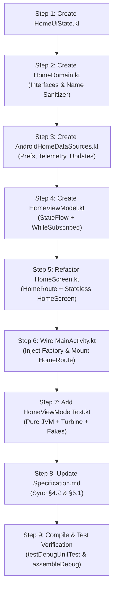

# HomeViewModel Refactor & Route/Screen Decoupling — Final Execution Plan

**Document:** `code_review/HomeViewModel_refactor_20261111_final.md`  
**Date:** 2026-11-11  
**Status:** APPROVED & READY TO EXECUTE  
**Target Repository:** [`samlu/CamMonitor`](https://github.com/samlu/CamMonitor)  
**Author:** AI Pair Programming Assistant  

---

## 1. Executive Summary & Architecture

This plan synthesizes all findings and corrections across 4 review passes into a concrete, sequential refactoring blueprint. It decouples the Home Command Center into a reactive, lifecycle-safe, 100% JVM-testable MVVM architecture conforming to [`Specification.md`](../Specification.md) §4.2 and §5.1.

```
┌────────────────────────────────────────────────────────────────────────┐
│                              MainActivity                              │
│  - Injects HomeViewModel using HomeViewModel.provideFactory(...)       │
│  - Mounts HomeRoute when currentScreen == AppScreen.HOME              │
└───────────────────────────────────┬────────────────────────────────────┘
                                    │ passes HomeViewModel & nav lambdas
                                    ▼
┌────────────────────────────────────────────────────────────────────────┐
│                               HomeRoute                                │ (Stateful Host)
│  - Collects uiState with collectAsStateWithLifecycle()                 │
│  - Triggers viewModel.onActivated() on entry                           │
│  - Handles Android Context tasks (open URL, change locale, settings)   │
└───────────────────────────────────┬────────────────────────────────────┘
                                    │ passes HomeUiState & pure callbacks
                                    ▼
┌────────────────────────────────────────────────────────────────────────┐
│                               HomeScreen                               │ (Pure Stateless UI)
│  - ZERO Android Context, ZERO Singletons, ZERO I/O                     │
│  - Renders loading spinner when !isLoaded to prevent UI/dialog jumps   │
│  - 100% previewable with @Preview and mock HomeUiState                 │
└────────────────────────────────────────────────────────────────────────┘
```

---

## 2. Step-by-Step Implementation Sequence



---

### Step 1: Create `HomeUiState.kt`
**File:** [`app/src/main/java/com/a0soft/gphone/camonitor/ui/home/HomeUiState.kt`](file:///E:/Antigravity/CamMonitor/app/src/main/java/com/a0soft/gphone/camonitor/ui/home/HomeUiState.kt)

Create the immutable snapshot model. Includes `isLoaded` (prevents first-frame dialog/layout jumps) and `lastConnectedMap` (preserves Option 2 relative timestamps):

```kotlin
package com.a0soft.gphone.camonitor.ui.home

import androidx.compose.runtime.Immutable
import com.a0soft.gphone.camonitor.data.model.PairedDevice
import com.a0soft.gphone.camonitor.data.update.ReleaseInfo
import com.a0soft.gphone.camonitor.ui.common.BatteryInfo

@Immutable
data class HomeUiState(
    val isLoaded: Boolean = false,
    val loadError: String? = null,
    val cameraName: String = "",
    val pairedViewers: List<PairedDevice> = emptyList(),
    val pairedCameras: List<PairedDevice> = emptyList(),
    val lastConnectedMap: Map<String, Long> = emptyMap(),
    val batteryInfo: BatteryInfo = BatteryInfo(percentage = -1, isCharging = false),
    val networkType: NetworkType = NetworkType.DISCONNECTED,
    val availableRelease: ReleaseInfo? = null,
    val isStealthIntroSeen: Boolean = false
) {
    val layout: HomeLayout
        get() = homeLayoutFor(pairedCameraCount = pairedCameras.size, pairedViewerCount = pairedViewers.size)
}
```

---

### Step 2: Create `HomeDomain.kt`
**File:** [`app/src/main/java/com/a0soft/gphone/camonitor/ui/home/HomeDomain.kt`](file:///E:/Antigravity/CamMonitor/app/src/main/java/com/a0soft/gphone/camonitor/ui/home/HomeDomain.kt)

Create domain abstractions and Unicode code-point safe device name sanitizer:

```kotlin
package com.a0soft.gphone.camonitor.ui.home

import com.a0soft.gphone.camonitor.data.update.ReleaseCheckResult
import com.a0soft.gphone.camonitor.data.update.ReleaseInfo
import com.a0soft.gphone.camonitor.ui.common.BatteryInfo
import kotlinx.coroutines.flow.Flow

interface HomePreferencesDataSource {
    fun isStealthIntroSeen(): Boolean
    fun setStealthIntroSeen(seen: Boolean)
    fun getLastConnectedMap(): Map<String, Long>
    fun clearConnectionHistory(deviceId: String)
}

interface TelemetryDataSource {
    val batteryFlow: Flow<BatteryInfo>
    val networkFlow: Flow<NetworkType>
}

interface UpdateRepository {
    suspend fun getCachedRelease(): ReleaseInfo?
    suspend fun saveCachedRelease(release: ReleaseInfo)
    suspend fun clearCachedRelease()
    suspend fun isVersionSkipped(version: String): Boolean
    suspend fun skipVersion(version: String)
    suspend fun shouldCheck(): Boolean
    suspend fun recordCheck()
    suspend fun checkLatestRelease(): ReleaseCheckResult
}

fun interface PeerCloser {
    fun closePeer(deviceId: String)
}

/**
 * Sanitizes device names: strips ISO control characters and clamps to maxCodePoints (default 32)
 * using code points to prevent slicing multi-byte UTF-16 surrogate pairs (e.g. emojis).
 */
fun sanitizeDeviceName(rawName: String, maxCodePoints: Int = 32): String {
    val filtered = rawName.trim().filter { !it.isISOControl() }
    val codePoints = filtered.codePoints().toArray()
    if (codePoints.size <= maxCodePoints) return filtered
    return String(codePoints, 0, maxCodePoints)
}
```

---

### Step 3: Create `AndroidHomeDataSources.kt`
**File:** [`app/src/main/java/com/a0soft/gphone/camonitor/ui/home/AndroidHomeDataSources.kt`](file:///E:/Antigravity/CamMonitor/app/src/main/java/com/a0soft/gphone/camonitor/ui/home/AndroidHomeDataSources.kt)

Implement Android platform bindings for storage, hardware telemetry callback flows, and update checks:

```kotlin
package com.a0soft.gphone.camonitor.ui.home

import android.content.BroadcastReceiver
import android.content.Context
import android.content.Intent
import android.content.IntentFilter
import android.net.ConnectivityManager
import android.net.Network
import android.net.NetworkCapabilities
import androidx.core.content.ContextCompat
import com.a0soft.gphone.camonitor.data.update.ReleaseCheckResult
import com.a0soft.gphone.camonitor.data.update.ReleaseChecker
import com.a0soft.gphone.camonitor.data.update.ReleaseInfo
import com.a0soft.gphone.camonitor.data.update.UpdatePreferenceManager
import com.a0soft.gphone.camonitor.log.AppLogger
import com.a0soft.gphone.camonitor.ui.common.BatteryHelper
import com.a0soft.gphone.camonitor.ui.common.BatteryInfo
import kotlinx.coroutines.channels.awaitClose
import kotlinx.coroutines.flow.Flow
import kotlinx.coroutines.flow.callbackFlow
import kotlinx.coroutines.flow.conflate

class AndroidHomePreferences(context: Context) : HomePreferencesDataSource {
    private val prefs = context.getSharedPreferences("cammonitor_ui_prefs", Context.MODE_PRIVATE)
    private val appContext = context.applicationContext

    override fun isStealthIntroSeen(): Boolean = prefs.getBoolean("stealth_intro_seen", false)

    override fun setStealthIntroSeen(seen: Boolean) {
        prefs.edit().putBoolean("stealth_intro_seen", seen).apply()
    }

    override fun getLastConnectedMap(): Map<String, Long> = CameraConnectionHistory.getAll(appContext)

    override fun clearConnectionHistory(deviceId: String) {
        CameraConnectionHistory.clear(appContext, deviceId)
    }
}

class AndroidTelemetryDataSource(private val context: Context) : TelemetryDataSource {

    override val batteryFlow: Flow<BatteryInfo> = callbackFlow {
        val receiver = object : BroadcastReceiver() {
            override fun onReceive(ctx: Context?, intent: Intent?) {
                trySend(BatteryHelper.getBatteryInfo(context))
            }
        }
        ContextCompat.registerReceiver(
            context,
            receiver,
            IntentFilter(Intent.ACTION_BATTERY_CHANGED),
            ContextCompat.RECEIVER_NOT_EXPORTED
        )
        trySend(BatteryHelper.getBatteryInfo(context))
        awaitClose {
            try {
                context.unregisterReceiver(receiver)
            } catch (_: Exception) {}
        }
    }.conflate()

    override val networkFlow: Flow<NetworkType> = callbackFlow {
        val cm = context.getSystemService(Context.CONNECTIVITY_SERVICE) as? ConnectivityManager
        if (cm == null) {
            trySend(NetworkType.DISCONNECTED)
            awaitClose {}
            return@callbackFlow
        }

        fun currentStatus(): NetworkType {
            val active = cm.activeNetwork ?: return NetworkType.DISCONNECTED
            val caps = cm.getNetworkCapabilities(active) ?: return NetworkType.DISCONNECTED
            return classifyNetwork(
                hasInternet = caps.hasCapability(NetworkCapabilities.NET_CAPABILITY_INTERNET),
                isValidated = caps.hasCapability(NetworkCapabilities.NET_CAPABILITY_VALIDATED),
                hasWifi = caps.hasTransport(NetworkCapabilities.TRANSPORT_WIFI),
                hasEthernet = caps.hasTransport(NetworkCapabilities.TRANSPORT_ETHERNET),
                hasCellular = caps.hasTransport(NetworkCapabilities.TRANSPORT_CELLULAR)
            )
        }

        val callback = object : ConnectivityManager.NetworkCallback() {
            override fun onAvailable(network: Network) { trySend(currentStatus()) }
            override fun onLost(network: Network) { trySend(currentStatus()) }
            override fun onCapabilitiesChanged(network: Network, caps: NetworkCapabilities) { trySend(currentStatus()) }
        }

        try {
            cm.registerDefaultNetworkCallback(callback)
            trySend(currentStatus())
        } catch (e: Exception) {
            AppLogger.w("AndroidTelemetry", "Failed to register network callback: ${e.message}")
            trySend(NetworkType.DISCONNECTED)
        }

        awaitClose {
            try {
                cm.unregisterNetworkCallback(callback)
            } catch (_: Exception) {}
        }
    }.conflate()
}

class AndroidUpdateRepository(context: Context) : UpdateRepository {
    private val updatePrefs = UpdatePreferenceManager(context)

    override suspend fun getCachedRelease(): ReleaseInfo? = updatePrefs.getCachedRelease()
    override suspend fun saveCachedRelease(release: ReleaseInfo) = updatePrefs.saveCachedRelease(release)
    override suspend fun clearCachedRelease() = updatePrefs.clearCachedRelease()
    override suspend fun isVersionSkipped(version: String): Boolean = updatePrefs.isVersionSkipped(version)
    override suspend fun skipVersion(version: String) = updatePrefs.skipVersion(version)
    override suspend fun shouldCheck(): Boolean = updatePrefs.shouldCheck()
    override suspend fun recordCheck() = updatePrefs.recordCheck()
    override suspend fun checkLatestRelease(): ReleaseCheckResult = ReleaseChecker.checkLatestRelease()
}
```

---

### Step 4: Create `HomeViewModel.kt`
**File:** [`app/src/main/java/com/a0soft/gphone/camonitor/ui/home/HomeViewModel.kt`](file:///E:/Antigravity/CamMonitor/app/src/main/java/com/a0soft/gphone/camonitor/ui/home/HomeViewModel.kt)

Pure `ViewModel` combining internal state with lifecycle-aware telemetry via `WhileSubscribed(5_000)`:

```kotlin
package com.a0soft.gphone.camonitor.ui.home

import androidx.lifecycle.ViewModel
import androidx.lifecycle.ViewModelProvider
import androidx.lifecycle.viewModelScope
import androidx.lifecycle.viewmodel.initializer
import androidx.lifecycle.viewmodel.viewModelFactory
import com.a0soft.gphone.camonitor.BuildConfig
import com.a0soft.gphone.camonitor.data.model.PairedDevice
import com.a0soft.gphone.camonitor.data.security.SecurityRepository
import com.a0soft.gphone.camonitor.data.update.ReleaseCheckResult
import com.a0soft.gphone.camonitor.data.update.ReleaseInfo
import com.a0soft.gphone.camonitor.log.AppLogger
import kotlinx.coroutines.CancellationException
import kotlinx.coroutines.CoroutineDispatcher
import kotlinx.coroutines.Dispatchers
import kotlinx.coroutines.flow.*
import kotlinx.coroutines.launch
import kotlinx.coroutines.sync.Mutex
import kotlinx.coroutines.sync.withLock
import kotlinx.coroutines.withContext

class HomeViewModel(
    private val securityRepo: SecurityRepository,
    private val preferencesDataSource: HomePreferencesDataSource,
    private val telemetryDataSource: TelemetryDataSource,
    private val updateRepository: UpdateRepository,
    private val peerCloser: PeerCloser,
    private val ioDispatcher: CoroutineDispatcher = Dispatchers.IO
) : ViewModel() {

    private data class InternalState(
        val isLoaded: Boolean = false,
        val loadError: String? = null,
        val cameraName: String = "",
        val pairedViewers: List<PairedDevice> = emptyList(),
        val pairedCameras: List<PairedDevice> = emptyList(),
        val lastConnectedMap: Map<String, Long> = emptyMap(),
        val availableRelease: ReleaseInfo? = null,
        val isStealthIntroSeen: Boolean = false
    )

    private val _internalState = MutableStateFlow(InternalState())
    private val activationMutex = Mutex()
    private val mutationMutex = Mutex()
    private var isNetworkCheckInFlight = false

    private val telemetryFlow = combine(
        telemetryDataSource.batteryFlow.distinctUntilChanged().onStart { emit(com.a0soft.gphone.camonitor.ui.common.BatteryInfo(percentage = -1, isCharging = false)) },
        telemetryDataSource.networkFlow.distinctUntilChanged().onStart { emit(NetworkType.DISCONNECTED) }
    ) { battery, network -> battery to network }

    val uiState: StateFlow<HomeUiState> = combine(_internalState, telemetryFlow) { internal, (battery, network) ->
        HomeUiState(
            isLoaded = internal.isLoaded,
            loadError = internal.loadError,
            cameraName = internal.cameraName,
            pairedViewers = internal.pairedViewers,
            pairedCameras = internal.pairedCameras,
            lastConnectedMap = internal.lastConnectedMap,
            batteryInfo = battery,
            networkType = network,
            availableRelease = internal.availableRelease,
            isStealthIntroSeen = internal.isStealthIntroSeen
        )
    }.stateIn(
        scope = viewModelScope,
        started = SharingStarted.WhileSubscribed(5_000),
        initialValue = HomeUiState()
    )

    fun onActivated() {
        viewModelScope.launch {
            activationMutex.withLock {
                withContext(ioDispatcher) {
                    reloadLocalData()
                    evaluateCachedRelease()
                    triggerNetworkUpdateCheck()
                }
            }
        }
    }

    private fun reloadLocalData() {
        runCatching {
            val viewers = runCatching { securityRepo.getPairedViewers() }.getOrElse { emptyList() }
            val cameras = runCatching { securityRepo.getPairedCameras() }.getOrElse { emptyList() }
            val name = runCatching { securityRepo.getDeviceName() }.getOrElse { "" }
            val seen = runCatching { preferencesDataSource.isStealthIntroSeen() }.getOrElse { false }
            val lastConnected = runCatching { preferencesDataSource.getLastConnectedMap() }.getOrElse { emptyMap() }

            _internalState.update { current ->
                current.copy(
                    isLoaded = true,
                    loadError = null,
                    cameraName = name,
                    pairedViewers = viewers,
                    pairedCameras = cameras,
                    lastConnectedMap = lastConnected,
                    isStealthIntroSeen = seen
                )
            }
        }.onFailure { e ->
            if (e is CancellationException) throw e
            AppLogger.w("HomeViewModel", "Failed to reload local data: ${e.message}")
            _internalState.update { current ->
                current.copy(
                    isLoaded = true,
                    loadError = e.message ?: "Failed to reload local data"
                )
            }
        }
    }

    fun renameCamera(newName: String) {
        val sanitized = sanitizeDeviceName(newName)
        if (sanitized.isEmpty()) return

        viewModelScope.launch {
            mutationMutex.withLock {
                withContext(ioDispatcher) {
                    runCatching {
                        securityRepo.setDeviceName(sanitized)
                        _internalState.update { it.copy(cameraName = sanitized) }
                    }.onFailure { e ->
                        if (e is CancellationException) throw e
                        AppLogger.w("HomeViewModel", "Failed to rename camera: ${e.message}")
                    }
                }
            }
        }
    }

    fun unpairDevice(deviceId: String) {
        viewModelScope.launch {
            mutationMutex.withLock {
                withContext(ioDispatcher) {
                    try {
                        // 1. Whitelist record revoked FIRST so no incoming signaling is accepted
                        runCatching { securityRepo.removePairedDevice(deviceId) }
                            .onFailure { e ->
                                if (e is CancellationException) throw e
                                AppLogger.w("HomeViewModel", "Failed to revoke paired device: ${e.message}")
                            }

                        // 2. Tear down WebRTC peer connection IMMEDIATELY
                        runCatching { peerCloser.closePeer(deviceId) }
                            .onFailure { e ->
                                if (e is CancellationException) throw e
                                AppLogger.w("HomeViewModel", "Failed to close WebRTC peer $deviceId: ${e.message}")
                            }

                        // 3. Purge auxiliary connection history independently
                        runCatching { preferencesDataSource.clearConnectionHistory(deviceId) }
                            .onFailure { e ->
                                if (e is CancellationException) throw e
                                AppLogger.w("HomeViewModel", "Failed to clear connection history for $deviceId: ${e.message}")
                            }
                    } finally {
                        // 4. Always reload so the UI accurately reflects latest state
                        reloadLocalData()
                    }
                }
            }
        }
    }

    fun markStealthIntroSeen() {
        viewModelScope.launch {
            mutationMutex.withLock {
                withContext(ioDispatcher) {
                    preferencesDataSource.setStealthIntroSeen(true)
                    _internalState.update { it.copy(isStealthIntroSeen = true) }
                }
            }
        }
    }

    fun skipVersion(version: String) {
        viewModelScope.launch {
            mutationMutex.withLock {
                withContext(ioDispatcher) {
                    updateRepository.skipVersion(version)
                    _internalState.update { it.copy(availableRelease = null) }
                }
            }
        }
    }

    fun dismissUpdateBanner() {
        _internalState.update { it.copy(availableRelease = null) }
    }

    private suspend fun evaluateCachedRelease() {
        runCatching {
            val cached = updateRepository.getCachedRelease()
            if (cached != null && !updateRepository.isVersionSkipped(cached.versionName)) {
                val eval = com.a0soft.gphone.camonitor.data.update.ReleaseChecker.evaluateRelease(cached, BuildConfig.VERSION_NAME)
                if (eval is ReleaseCheckResult.UpdateAvailable) {
                    _internalState.update { it.copy(availableRelease = cached) }
                } else {
                    updateRepository.clearCachedRelease()
                }
            }
        }.onFailure { e ->
            if (e is CancellationException) throw e
            AppLogger.w("HomeViewModel", "Error evaluating cached release: ${e.message}")
        }
    }

    private suspend fun triggerNetworkUpdateCheck() {
        if (isNetworkCheckInFlight) return
        if (!updateRepository.shouldCheck()) return

        isNetworkCheckInFlight = true
        try {
            updateRepository.recordCheck()
            val result = updateRepository.checkLatestRelease()
            if (result is ReleaseCheckResult.UpdateAvailable) {
                if (!updateRepository.isVersionSkipped(result.release.versionName)) {
                    updateRepository.saveCachedRelease(result.release)
                    _internalState.update { it.copy(availableRelease = result.release) }
                }
            }
        } catch (e: Exception) {
            if (e is CancellationException) throw e
            AppLogger.w("HomeViewModel", "Error checking latest release: ${e.message}")
        } finally {
            isNetworkCheckInFlight = false
        }
    }

    companion object {
        fun provideFactory(
            securityRepo: SecurityRepository,
            preferencesDataSource: HomePreferencesDataSource,
            telemetryDataSource: TelemetryDataSource,
            updateRepository: UpdateRepository,
            peerCloser: PeerCloser
        ): ViewModelProvider.Factory = viewModelFactory {
            initializer {
                HomeViewModel(
                    securityRepo = securityRepo,
                    preferencesDataSource = preferencesDataSource,
                    telemetryDataSource = telemetryDataSource,
                    updateRepository = updateRepository,
                    peerCloser = peerCloser
                )
            }
        }
    }
}
```

---

### Step 5: Refactor `HomeScreen.kt`
**File:** [`app/src/main/java/com/a0soft/gphone/camonitor/ui/home/HomeScreen.kt`](file:///E:/Antigravity/CamMonitor/app/src/main/java/com/a0soft/gphone/camonitor/ui/home/HomeScreen.kt)

Export `HomeRoute` (stateful) and `HomeScreen` (stateless). `HomeScreen` is context-free, Singleton-free, and handles all dialogs locally via callbacks:

```kotlin
@Composable
fun HomeRoute(
    viewModel: HomeViewModel,
    onStartCameraMode: (startInStealth: Boolean) -> Unit,
    onPairNewViewer: () -> Unit,
    onStartViewerMode: (deviceId: String) -> Unit,
    onPairNewCamera: () -> Unit,
    onOpenPairedDevices: () -> Unit,
    onOpenLogs: () -> Unit,
    onOpenAbout: () -> Unit
) {
    val context = LocalContext.current
    val uiState by viewModel.uiState.collectAsStateWithLifecycle()

    LaunchedEffect(Unit) {
        UpdateNotificationHelper.dismissUpdateNotification(context)
        viewModel.onActivated()
    }

    HomeScreen(
        uiState = uiState,
        currentLanguageTag = LocaleHelper.getCurrentLanguageTag(context),
        onRenameCamera = viewModel::renameCamera,
        onUnpairCamera = viewModel::unpairDevice,
        onMarkStealthIntroSeen = viewModel::markStealthIntroSeen,
        onSkipVersion = viewModel::skipVersion,
        onDismissUpdate = viewModel::dismissUpdateBanner,
        onOpenReleaseUrl = { url ->
            try {
                val intent = Intent(Intent.ACTION_VIEW, Uri.parse(url)).apply {
                    addFlags(Intent.FLAG_ACTIVITY_NEW_TASK)
                }
                context.startActivity(intent)
            } catch (e: Exception) {
                AppLogger.w("HomeRoute", "Failed to open release URL: ${e.message}")
            }
        },
        onChangeLanguage = { tag ->
            LocaleHelper.setLanguage(context, tag)
        },
        onOpenSystemLanguageSettings = {
            LocaleHelper.openSystemLanguageSettings(context)
        },
        onStartCameraMode = onStartCameraMode,
        onPairNewViewer = onPairNewViewer,
        onStartViewerMode = onStartViewerMode,
        onPairNewCamera = onPairNewCamera,
        onOpenPairedDevices = onOpenPairedDevices,
        onOpenLogs = onOpenLogs,
        onOpenAbout = onOpenAbout
    )
}

@OptIn(ExperimentalMaterial3Api::class)
@Composable
fun HomeScreen(
    uiState: HomeUiState,
    currentLanguageTag: String,
    onRenameCamera: (String) -> Unit,
    onUnpairCamera: (String) -> Unit,
    onMarkStealthIntroSeen: () -> Unit,
    onSkipVersion: (String) -> Unit,
    onDismissUpdate: () -> Unit,
    onOpenReleaseUrl: (String) -> Unit,
    onChangeLanguage: (String) -> Unit,
    onOpenSystemLanguageSettings: () -> Unit,
    onStartCameraMode: (startInStealth: Boolean) -> Unit,
    onPairNewViewer: () -> Unit,
    onStartViewerMode: (deviceId: String) -> Unit,
    onPairNewCamera: () -> Unit,
    onOpenPairedDevices: () -> Unit,
    onOpenLogs: () -> Unit,
    onOpenAbout: () -> Unit
) {
    if (!uiState.isLoaded) {
        Box(modifier = Modifier.fillMaxSize(), contentAlignment = Alignment.Center) {
            CircularProgressIndicator()
        }
        return
    }

    var showRenameDialog by remember { mutableStateOf(false) }
    var showStealthIntro by remember { mutableStateOf(false) }
    var cameraToUnpair by remember { mutableStateOf<PairedDevice?>(null) }
    var showLanguageDialog by remember { mutableStateOf(false) }
    val scrollState = rememberScrollState()

    Scaffold(
        contentWindowInsets = WindowInsets.safeDrawing,
        topBar = {
            TopAppBar(
                title = {
                    Text(
                        text = stringResource(R.string.app_name),
                        style = MaterialTheme.typography.titleLarge,
                        fontWeight = FontWeight.Bold
                    )
                },
                actions = {
                    IconButton(onClick = { showLanguageDialog = true }) {
                        Icon(Icons.Default.Language, contentDescription = stringResource(R.string.cd_language_settings))
                    }
                    IconButton(onClick = onOpenLogs) {
                        Icon(Icons.Default.Description, contentDescription = stringResource(R.string.system_logs))
                    }
                    IconButton(onClick = onOpenPairedDevices) {
                        Icon(Icons.Default.Devices, contentDescription = stringResource(R.string.paired_devices))
                    }
                    IconButton(onClick = onOpenAbout) {
                        Icon(Icons.Default.Info, contentDescription = stringResource(R.string.about_title))
                    }
                },
                colors = TopAppBarDefaults.topAppBarColors(
                    containerColor = MaterialTheme.colorScheme.surface
                )
            )
        }
    ) { innerPadding ->
        BoxWithConstraints(
            modifier = Modifier
                .fillMaxSize()
                .padding(innerPadding)
        ) {
            val configuration = LocalConfiguration.current
            val isLandscape = (maxWidth > maxHeight) ||
                (configuration.orientation == Configuration.ORIENTATION_LANDSCAPE) ||
                (configuration.screenWidthDp > configuration.screenHeightDp)

            Column(
                modifier = Modifier
                    .fillMaxSize()
                    .verticalScroll(scrollState)
                    .padding(horizontal = if (isLandscape) 24.dp else 20.dp, vertical = 12.dp),
                verticalArrangement = Arrangement.spacedBy(16.dp)
            ) {
                // Telemetry Bar
                HardwarePreflightBar(batteryInfo = uiState.batteryInfo, networkType = uiState.networkType)

                // Update Banner Card
                uiState.availableRelease?.let { release ->
                    UpdateBannerCard(
                        release = release,
                        onViewUpdate = onOpenReleaseUrl,
                        onSkipVersion = onSkipVersion,
                        onDismiss = onDismissUpdate
                    )
                }

                // Consoles Layout
                val startStealth: () -> Unit = {
                    if (uiState.isStealthIntroSeen) onStartCameraMode(true) else showStealthIntro = true
                }
                val broadcaster: @Composable (Modifier) -> Unit = { m ->
                    if (uiState.layout == HomeLayout.CAMERAS_FIRST) {
                        CompactBroadcasterRow(
                            cameraName = uiState.cameraName,
                            onRename = { showRenameDialog = true },
                            onPairViewer = onPairNewViewer,
                            modifier = m
                        )
                    } else {
                        BroadcasterConsoleCard(
                            cameraName = uiState.cameraName,
                            pairedViewers = uiState.pairedViewers,
                            batteryInfo = uiState.batteryInfo,
                            onRename = { showRenameDialog = true },
                            onStartNormal = { onStartCameraMode(false) },
                            onStartStealth = startStealth,
                            onPairViewer = onPairNewViewer,
                            modifier = m
                        )
                    }
                }
                val cameras: @Composable (Modifier) -> Unit = { m ->
                    MonitoredCamerasSection(
                        pairedCameras = uiState.pairedCameras,
                        lastConnectedMap = uiState.lastConnectedMap,
                        onConnect = onStartViewerMode,
                        onPairCamera = onPairNewCamera,
                        onConfirmRemoveCamera = { cameraToUnpair = it },
                        modifier = m
                    )
                }
                val first = if (uiState.layout == HomeLayout.CAMERAS_FIRST) cameras else broadcaster
                val second = if (uiState.layout == HomeLayout.CAMERAS_FIRST) broadcaster else cameras

                if (isLandscape) {
                    Row(
                        modifier = Modifier
                            .fillMaxWidth()
                            .height(IntrinsicSize.Max),
                        horizontalArrangement = Arrangement.spacedBy(16.dp)
                    ) {
                        first(Modifier.weight(1f).fillMaxHeight())
                        second(Modifier.weight(1f).fillMaxHeight())
                    }
                } else {
                    first(Modifier.fillMaxWidth())
                    Spacer(modifier = Modifier.height(12.dp))
                    second(Modifier.fillMaxWidth())
                }
            }
        }
    }

    // Dialogs: Stealth Intro, Rename, Unpair, Language
    if (showStealthIntro) {
        AlertDialog(
            onDismissRequest = { showStealthIntro = false },
            icon = { Icon(Icons.Default.DarkMode, contentDescription = null) },
            title = { Text(stringResource(R.string.home_stealth_intro_title)) },
            text = { Text(stringResource(R.string.home_stealth_intro_message)) },
            confirmButton = {
                Button(onClick = {
                    onMarkStealthIntroSeen()
                    showStealthIntro = false
                    onStartCameraMode(true)
                }) {
                    Text(stringResource(R.string.home_stealth_intro_confirm))
                }
            },
            dismissButton = {
                TextButton(onClick = { showStealthIntro = false }) {
                    Text(stringResource(R.string.action_cancel))
                }
            }
        )
    }

    if (showRenameDialog) {
        var tempName by remember { mutableStateOf(uiState.cameraName) }
        AlertDialog(
            onDismissRequest = { showRenameDialog = false },
            title = { Text(stringResource(R.string.dialog_rename_camera_title)) },
            text = {
                OutlinedTextField(
                    value = tempName,
                    onValueChange = { if (it.codePoints().count() <= 32) tempName = it },
                    label = { Text(stringResource(R.string.dialog_camera_name_label)) },
                    singleLine = true,
                    supportingText = { Text("${tempName.codePoints().count()}/32") }
                )
            },
            confirmButton = {
                TextButton(
                    onClick = {
                        val sanitized = sanitizeDeviceName(tempName)
                        if (sanitized.isNotEmpty()) {
                            onRenameCamera(sanitized)
                        }
                        showRenameDialog = false
                    }
                ) {
                    Text(stringResource(R.string.action_save))
                }
            },
            dismissButton = {
                TextButton(onClick = { showRenameDialog = false }) {
                    Text(stringResource(R.string.action_cancel))
                }
            }
        )
    }

    cameraToUnpair?.let { targetCamera ->
        AlertDialog(
            onDismissRequest = { cameraToUnpair = null },
            icon = {
                Icon(
                    imageVector = Icons.Default.Warning,
                    contentDescription = null,
                    tint = MaterialTheme.colorScheme.error
                )
            },
            title = { Text(stringResource(R.string.home_confirm_unpair_title)) },
            text = {
                Text(stringResource(R.string.home_confirm_unpair_message, targetCamera.name))
            },
            confirmButton = {
                Button(
                    onClick = {
                        onUnpairCamera(targetCamera.deviceId)
                        cameraToUnpair = null
                    },
                    colors = ButtonDefaults.buttonColors(
                        containerColor = MaterialTheme.colorScheme.error
                    )
                ) {
                    Text(stringResource(R.string.home_confirm_unpair_action))
                }
            },
            dismissButton = {
                TextButton(onClick = { cameraToUnpair = null }) {
                    Text(stringResource(R.string.action_cancel))
                }
            }
        )
    }

    if (showLanguageDialog) {
        var selectedTag by remember { mutableStateOf(currentLanguageTag) }
        AlertDialog(
            onDismissRequest = { showLanguageDialog = false },
            title = { Text(stringResource(R.string.language_picker_title)) },
            text = {
                Column(
                    modifier = Modifier
                        .fillMaxWidth()
                        .verticalScroll(rememberScrollState()),
                    verticalArrangement = Arrangement.spacedBy(2.dp)
                ) {
                    val options = listOf(
                        LocaleHelper.LANGUAGE_FOLLOW_SYSTEM to stringResource(R.string.language_system_default),
                        LocaleHelper.LANGUAGE_ZH_CN to stringResource(R.string.language_simplified_chinese),
                        LocaleHelper.LANGUAGE_ZH_TW to stringResource(R.string.language_traditional_chinese),
                        LocaleHelper.LANGUAGE_EN to stringResource(R.string.language_english),
                        LocaleHelper.LANGUAGE_JA to stringResource(R.string.language_japanese)
                    )

                    options.forEach { (tag, label) ->
                        Row(
                            modifier = Modifier
                                .fillMaxWidth()
                                .selectable(
                                    selected = selectedTag == tag,
                                    onClick = {
                                        selectedTag = tag
                                        showLanguageDialog = false
                                        onChangeLanguage(tag)
                                    }
                                )
                                .padding(vertical = 4.dp),
                            verticalAlignment = Alignment.CenterVertically
                        ) {
                            RadioButton(
                                selected = selectedTag == tag,
                                onClick = {
                                    selectedTag = tag
                                    showLanguageDialog = false
                                    onChangeLanguage(tag)
                                }
                            )
                            Spacer(modifier = Modifier.width(8.dp))
                            Text(text = label, style = MaterialTheme.typography.bodyLarge)
                        }
                    }

                    if (Build.VERSION.SDK_INT >= Build.VERSION_CODES.TIRAMISU) {
                        HorizontalDivider(modifier = Modifier.padding(vertical = 4.dp))
                        TextButton(
                            onClick = {
                                showLanguageDialog = false
                                onOpenSystemLanguageSettings()
                            },
                            modifier = Modifier.fillMaxWidth()
                        ) {
                            Icon(Icons.Default.Settings, contentDescription = null, modifier = Modifier.size(18.dp))
                            Spacer(modifier = Modifier.width(8.dp))
                            Text(stringResource(R.string.language_open_system_settings))
                        }
                    }
                }
            },
            confirmButton = {},
            dismissButton = {
                TextButton(onClick = { showLanguageDialog = false }) {
                    Text(stringResource(R.string.action_cancel))
                }
            }
        )
    }
}
```

---

### Step 6: Wire `MainActivity.kt`
**File:** [`app/src/main/java/com/a0soft/gphone/camonitor/MainActivity.kt`](file:///E:/Antigravity/CamMonitor/app/src/main/java/com/a0soft/gphone/camonitor/MainActivity.kt)

Instantiate `HomeViewModel` via `HomeViewModel.provideFactory` and pass it to `HomeRoute`:

```kotlin
// In MainActivity.kt inside onCreate setContent:
val homeViewModel: HomeViewModel = viewModel(
    factory = HomeViewModel.provideFactory(
        securityRepo = securityRepo,
        preferencesDataSource = remember { AndroidHomePreferences(applicationContext) },
        telemetryDataSource = remember { AndroidTelemetryDataSource(applicationContext) },
        updateRepository = remember { AndroidUpdateRepository(applicationContext) },
        peerCloser = { deviceId -> CamMonitorApp.instance.webRtcManager.closePeer(deviceId) }
    )
)

// Inside when (currentScreen):
AppScreen.HOME -> {
    HomeRoute(
        viewModel = homeViewModel,
        onStartCameraMode = { stealth ->
            checkAndRequestPermissions(getCameraPermissions()) {
                stealthIntent.request(stealth)
                when (broadcasterLaunchRoute(securityRepo.getPairedViewers().size)) {
                    BroadcasterLaunchRoute.PAIR_VIEWER_FIRST -> navigateTo(AppScreen.CAMERA_PAIRING)
                    BroadcasterLaunchRoute.START_CAMERA -> navigateTo(AppScreen.CAMERA_MODE)
                }
            }
        },
        onPairNewViewer = {
            checkAndRequestPermissions(getCameraPermissions()) {
                stealthIntent.clear()
                navigateTo(AppScreen.CAMERA_PAIRING)
            }
        },
        onStartViewerMode = { deviceId ->
            selectedCameraDeviceId = deviceId
            navigateTo(AppScreen.VIEWER_MODE)
        },
        onPairNewCamera = {
            checkAndRequestPermissions(listOf(Manifest.permission.CAMERA)) {
                navigateTo(AppScreen.VIEWER_PAIRING)
            }
        },
        onOpenPairedDevices = { navigateTo(AppScreen.MANAGE_DEVICES) },
        onOpenLogs = { navigateTo(AppScreen.LOGS) },
        onOpenAbout = { navigateTo(AppScreen.ABOUT) }
    )
}
```

---

### Step 7: Create Pure JVM Unit Tests (`HomeViewModelTest.kt`)
**File:** [`app/src/test/java/com/a0soft/gphone/camonitor/home/HomeViewModelTest.kt`](file:///E:/Antigravity/CamMonitor/app/src/test/java/com/a0soft/gphone/camonitor/home/HomeViewModelTest.kt)

Comprehensive unit test suite running on JVM with Turbine and handwritten fakes (0 Android stubs, 0 MockK):

```kotlin
package com.a0soft.gphone.camonitor.home

import app.cash.turbine.test
import com.a0soft.gphone.camonitor.data.model.PairedDevice
import com.a0soft.gphone.camonitor.data.model.SignalingEnvelope
import com.a0soft.gphone.camonitor.data.security.SecurityRepository
import com.a0soft.gphone.camonitor.data.update.ReleaseCheckResult
import com.a0soft.gphone.camonitor.data.update.ReleaseInfo
import com.a0soft.gphone.camonitor.ui.common.BatteryInfo
import com.a0soft.gphone.camonitor.ui.home.*
import kotlinx.coroutines.Dispatchers
import kotlinx.coroutines.ExperimentalCoroutinesApi
import kotlinx.coroutines.flow.MutableSharedFlow
import kotlinx.coroutines.test.*
import org.junit.After
import org.junit.Assert.*
import org.junit.Before
import org.junit.Test
import java.security.KeyPair

@OptIn(ExperimentalCoroutinesApi::class)
class HomeViewModelTest {

    private val testDispatcher = StandardTestDispatcher()

    private class FakePreferences : HomePreferencesDataSource {
        var seen = false
        val history = mutableMapOf<String, Long>()
        override fun isStealthIntroSeen(): Boolean = seen
        override fun setStealthIntroSeen(seen: Boolean) { this.seen = seen }
        override fun getLastConnectedMap(): Map<String, Long> = history.toMap()
        override fun clearConnectionHistory(deviceId: String) { history.remove(deviceId) }
    }

    private class FakeTelemetry : TelemetryDataSource {
        val battery = MutableSharedFlow<BatteryInfo>(replay = 1)
        val network = MutableSharedFlow<NetworkType>(replay = 1)
        override val batteryFlow = battery
        override val networkFlow = network
    }

    private class FakeUpdates : UpdateRepository {
        var cached: ReleaseInfo? = null
        var skipped = mutableSetOf<String>()
        override suspend fun getCachedRelease() = cached
        override suspend fun saveCachedRelease(release: ReleaseInfo) { cached = release }
        override suspend fun clearCachedRelease() { cached = null }
        override suspend fun isVersionSkipped(version: String) = version in skipped
        override suspend fun skipVersion(version: String) { skipped.add(version) }
        override suspend fun shouldCheck() = false
        override suspend fun recordCheck() {}
        override suspend fun checkLatestRelease() = ReleaseCheckResult.NoUpdate
    }

    private class FakeSecurity : SecurityRepository {
        var name = "Initial Camera"
        val devices = mutableListOf<PairedDevice>()
        override fun getDeviceId() = "dev-1"
        override fun getDeviceName() = name
        override fun setDeviceName(name: String) { this.name = name }
        override fun getDevicePublicKeyBase64() = "pk"
        override fun getKeyPair(): KeyPair = throw NotImplementedError()
        override fun generatePairingOtp() = "123456"
        override fun setActivePairingOtp(otp: String) {}
        override fun getActivePairingOtp(): String? = null
        override fun clearPairingOtp() {}
        override fun getPairedDevices() = devices.toList()
        override fun addPairedDevice(device: PairedDevice, maxLimit: Int) = devices.add(device)
        override fun removePairedDevice(deviceId: String) { devices.removeAll { it.deviceId == deviceId } }
        override fun isDeviceWhitelisted(deviceId: String) = devices.any { it.deviceId == deviceId }
        override fun getPairedDevice(deviceId: String) = devices.find { it.deviceId == deviceId }
        override fun createEnvelope(recipientId: String, plaintextJson: String, secretOrDerivedKey: ByteArray): SignalingEnvelope = throw NotImplementedError()
        override fun verifyAndDecryptEnvelope(envelope: SignalingEnvelope, secretOrDerivedKey: ByteArray, isOtpKey: Boolean) = null
    }

    @Before
    fun setUp() {
        Dispatchers.setMain(testDispatcher)
    }

    @After
    fun tearDown() {
        Dispatchers.resetMain()
    }

    @Test
    fun initialState_isNotLoaded() = runTest(testDispatcher) {
        val vm = HomeViewModel(FakeSecurity(), FakePreferences(), FakeTelemetry(), FakeUpdates(), PeerCloser {}, testDispatcher)
        assertFalse(vm.uiState.value.isLoaded)
    }

    @Test
    fun onActivated_loadsDataAndResolvesCamerasFirstLayout() = runTest(testDispatcher) {
        val security = FakeSecurity().apply {
            devices.add(PairedDevice("cam1", "4F", "pk1", "CAMERA", 1000L))
        }
        val prefs = FakePreferences().apply { history["cam1"] = 5000L }
        val vm = HomeViewModel(security, prefs, FakeTelemetry(), FakeUpdates(), PeerCloser {}, testDispatcher)

        vm.uiState.test {
            assertEquals(false, awaitItem().isLoaded)

            vm.onActivated()
            testDispatcher.scheduler.advanceUntilIdle()

            val loaded = awaitItem()
            assertTrue(loaded.isLoaded)
            assertEquals("Initial Camera", loaded.cameraName)
            assertEquals(1, loaded.pairedCameras.size)
            assertEquals(0, loaded.pairedViewers.size)
            assertEquals(HomeLayout.CAMERAS_FIRST, loaded.layout)
            assertEquals(5000L, loaded.lastConnectedMap["cam1"])
        }
    }

    @Test
    fun unpairDevice_revokesKey_clearsHistory_andClosesPeer() = runTest(testDispatcher) {
        val security = FakeSecurity().apply {
            devices.add(PairedDevice("cam1", "4F", "pk1", "CAMERA", 1000L))
        }
        val prefs = FakePreferences().apply { history["cam1"] = 5000L }
        var closedPeerId = ""
        val vm = HomeViewModel(security, prefs, FakeTelemetry(), FakeUpdates(), { closedPeerId = it }, testDispatcher)

        vm.onActivated()
        testDispatcher.scheduler.advanceUntilIdle()

        vm.unpairDevice("cam1")
        testDispatcher.scheduler.advanceUntilIdle()

        assertEquals("cam1", closedPeerId)
        assertTrue(security.devices.isEmpty())
        assertFalse("cam1" in prefs.history)
        assertEquals(0, vm.uiState.value.pairedCameras.size)
    }

    @Test
    fun renameCamera_sanitizesAndClampsCodePoints() = runTest(testDispatcher) {
        val security = FakeSecurity()
        val vm = HomeViewModel(security, FakePreferences(), FakeTelemetry(), FakeUpdates(), PeerCloser {}, testDispatcher)

        val input = "😀".repeat(35)
        vm.renameCamera(input)
        testDispatcher.scheduler.advanceUntilIdle()

        assertEquals(32, vm.uiState.value.cameraName.codePoints().count())
        assertEquals(String("😀".repeat(32).codePoints().toArray(), 0, 32), security.name)
    }
}
```

---

### Step 8: Update `Specification.md`
**File:** [`Specification.md`](file:///E:/Antigravity/CamMonitor/Specification.md)

Synchronize sections §4.2 (MVVM Layering) and §5.1 (Home Command Center architecture) to reflect:
1. `HomeRoute` (Stateful Host) / `HomeScreen` (Stateless UI) boundary.
2. Injected `HomeViewModel` with domain data sources (`HomePreferencesDataSource`, `TelemetryDataSource`, `UpdateRepository`).
3. Hardware telemetry lifecycle safety via `WhileSubscribed(5_000)`.

---

### Step 9: Verification Gate & Commands

Execute in PowerShell on Windows:

```powershell
# 1. Run all unit tests (184 unit tests)
.\gradlew.bat testDebugUnitTest

# 2. Assemble debug APK to ensure compilation, ProGuard, and resource packaging
.\gradlew.bat assembleDebug

# 3. Optional: Install to connected Pixel 10 Pro to verify live execution
$apk = Get-ChildItem app\build\outputs\apk\debug\*.apk | Sort-Object LastWriteTime -Descending | Select-Object -First 1 -ExpandProperty FullName
& "E:\Android\Sdk\platform-tools\adb.exe" -s 5A111FDCH000GG install -r $apk
& "E:\Android\Sdk\platform-tools\adb.exe" -s 5A111FDCH000GG shell am start -n com.a0soft.gphone.camonitor/.MainActivity
```

---

## 3. Checklist of Artifacts

- [x] `app/src/main/java/com/a0soft/gphone/camonitor/ui/home/HomeUiState.kt`
- [x] `app/src/main/java/com/a0soft/gphone/camonitor/ui/home/HomeDomain.kt`
- [x] `app/src/main/java/com/a0soft/gphone/camonitor/ui/home/AndroidHomeDataSources.kt`
- [x] `app/src/main/java/com/a0soft/gphone/camonitor/ui/home/HomeViewModel.kt`
- [x] `app/src/main/java/com/a0soft/gphone/camonitor/ui/home/HomeScreen.kt`
- [x] `app/src/main/java/com/a0soft/gphone/camonitor/MainActivity.kt`
- [x] `app/src/test/java/com/a0soft/gphone/camonitor/home/HomeViewModelTest.kt`
- [x] `Specification.md` (§4.2 & §5.1)

---

## 4. Post-Implementation Review Findings & Refinements

### Finding 1: Unpairing Peer Leak & Indefinite Loading on Initial Failure
- **Problem**: In `HomeViewModel.unpairDevice()`, if clearing history threw an exception, `peerCloser.closePeer(deviceId)` was skipped, leaving the WebRTC session open. Furthermore, if `reloadLocalData()` threw on initial load, `isLoaded` remained `false`, stranding the user indefinitely on `CircularProgressIndicator`.
- **Resolution**:
  - Closes the active peer immediately after security revocation before clearing preferences history.
  - Places `reloadLocalData()` in a `finally` block.
  - Ensures `isLoaded = true` is published even on initial read errors.

### Finding 2: Partial Storage Read Failure Wiping Paired Devices
- **Problem**: `reloadLocalData()` substituted empty lists upon read failures and set `loadError = null`, wiping paired devices from UI on transient Keystore errors without surfacing an error.
- **Resolution**:
  - Preserves last-known values using `runCatching` + `.getOrDefault(current.xxx)`.
  - Records error in `HomeUiState.loadError`.
  - Renders a warning card banner in `HomeScreen` with an explicit `Retry` action (`action_retry`) translated across all 4 locales.

### Finding 3: Foreground Return Lifecycle Synchronization
- **Problem**: `HomeRoute` previously invoked `onActivated()` inside `LaunchedEffect(Unit)`. This only executed upon entering the composition tree and did not run when returning from pairing flows, system settings, or backgrounding while `HomeRoute` remained composed.
- **Resolution**: Migrated to `androidx.lifecycle.compose.LifecycleResumeEffect(Unit)`, triggering data refreshes and update notification dismissals on every Activity `ON_RESUME`.

### Finding 4: Redundant Network In-Flight Flag
- **Problem**: `isNetworkCheckInFlight` in `HomeViewModel` was redundant because its sole caller was already serialized by `activationMutex.withLock`.
- **Resolution**: Removed the flag and simplified `triggerNetworkUpdateCheck()`.
